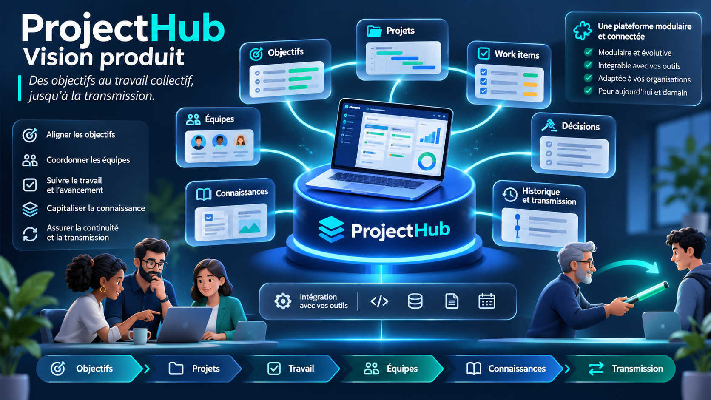

# ProjectHub

**ProjectHub** is an evolving project and work management platform designed to connect organizational goals, projects, teams and execution tools.

> Status: **Discovery**. This repository currently contains the public documentation foundation for **ProjectHub Discovery Baseline V1.0**. It is not yet a functional application.

[](docs/01-product/00-product-vision.md)

*ProjectHub product vision (concept illustration). [Explore the vision](docs/01-product/00-product-vision.md) or [browse the Product documentation](docs/01-product/README.md).*

## Product direction

- **Organizations** own their data and define the primary security boundary.
- **Workspaces** organize collaboration, projects and access within an organization.
- **Teams** can work across workspaces.
- **Projects** connect outcomes and deliverables to **WorkItems**.
- **Integrations** can link ProjectHub to external engineering and collaboration tools.

The long-term direction includes a self-hostable open source distribution and a managed SaaS service. Product scope, pricing and licensing remain subject to validation.

## Target architecture

The proposed technology foundation is **Django / Django REST Framework**, **Next.js / React / TypeScript** and **PostgreSQL**, initially as a modular monolith.

The target domain map contains 13 modules:

```text
core · identity · organizations · portfolios · projects · workitems
planning · views · collaboration · governance · integrations
automation · reporting
```

These are **target domain boundaries**, not a commitment to implement every module in the first release.

## Documentation

Start with [docs/README.md](docs/README.md). The public Discovery Baseline is organized under `docs/00-context/` through `docs/06-validation/`.

- [Project history](docs/00-context/00-project-history.md)
- [Public source register](docs/00-context/01-source-register.md)

## Project status and contributions

This is an early-stage project. Issues can be used to discuss validated, non-sensitive product requirements. Please do **not** publish personal information, third-party documents, credentials or security findings in public issues.

No license has been selected yet. **Public visibility alone does not grant permission to reuse, modify or redistribute the code.** The distribution and contribution policies will be defined before the first public source-code release.

## Security and privacy

Operational documents from pilot organizations, internal analyses, credentials and infrastructure details are **not hosted in this public repository**. The public source register contains sanitized references only.

## Maintainer

Project initiated in the [tawounfouet](https://github.com/tawounfouet) GitHub account.
