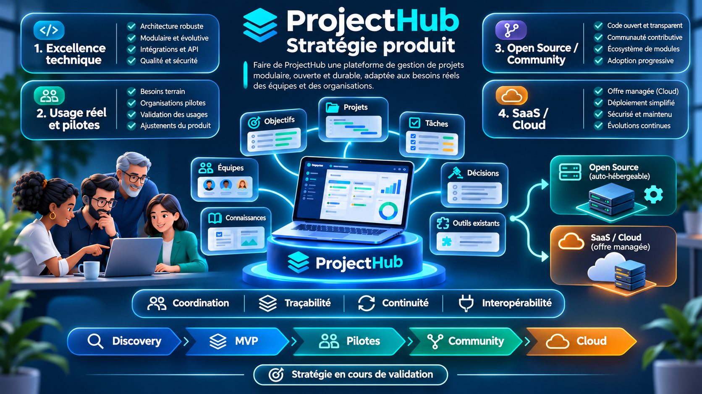
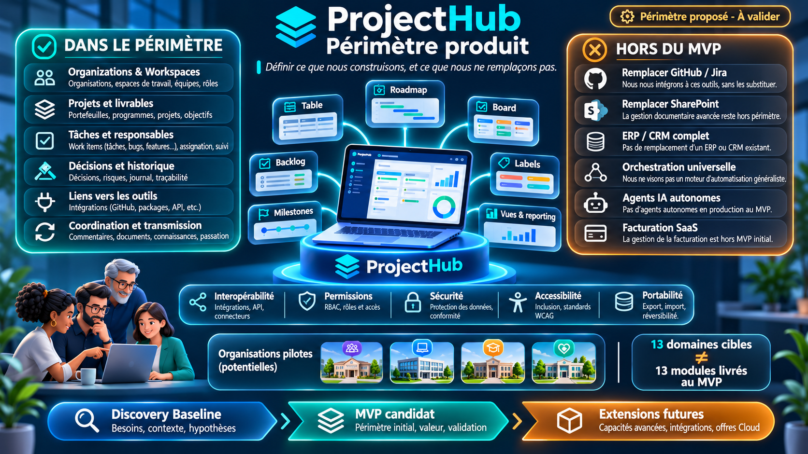

# 01 - Product

Éditions **publiques expurgées**, publiées dans le cadre du lot **PUBLIC-01** de ProjectHub Discovery Baseline V1.0 :

1. [Vision produit](00-product-vision.md) : mission candidate, problèmes, utilisateurs et valeur à vérifier.
2. [Stratégie produit](01-product-strategy.md) : hypothèses de positionnement, validation, Community et Cloud.
3. [Périmètre produit](02-product-scope.md) : fonctions candidates, exclusions du MVP et portes E0/E1.

## Illustrations du produit

### 1. Vision produit

La vision de ProjectHub : objectifs, coordination, traçabilité et transmission du travail.

### 2. Stratégie produit

La stratégie candidate de ProjectHub : Engineering, usages internes, Community et Cloud.

### 3. Périmètre produit

Les capacités candidates, les frontières du MVP et les évolutions envisagées.

**Statut : draft.** Ces documents sont distincts des versions privées exhaustives ; leur publication dans GitHub ne vaut pas approbation métier du contenu.

Lire la [politique de publication](../PUBLICATION-POLICY.md) et le [contexte canonique](../00-context/02-canonical-context.md).
