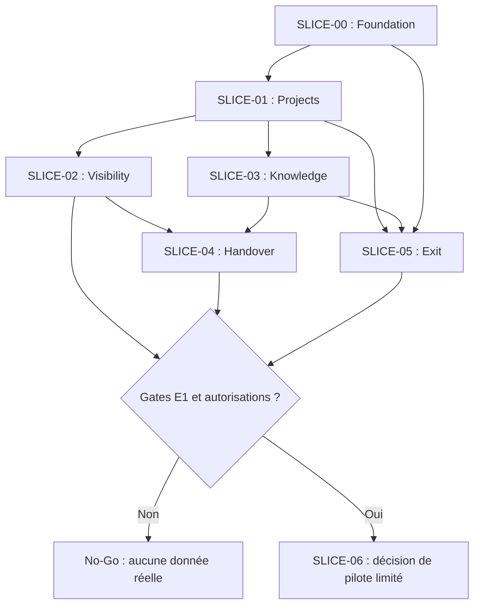

# ProjectHub - Backlog priorisé du MVP

> **Édition publique expurgée - draft.** Les 45 items `PH-BLG-001..045` sont des propositions documentaires, **pas** des Issues GitHub déjà créées. Aucun sprint, estimation, responsable d'implémentation ou déploiement n'est annoncé. L'édition privée possède des fiches détaillées et des liens opérationnels qui ne sont pas publiés.

## 1. Objectif de la livraison

Éprouver un parcours **qualifier -> responsabiliser -> suivre -> documenter -> transmettre -> exporter**, avec au moins deux Organizations fictives isolées.

- **E0** : démonstration reproductible à partir de données synthétiques ;
- **E1** : éventuel pilote de données réelles uniquement après autorisations, preuves et décision distincte ;
- **P0-G** : gate de sécurité ou de données, sans signifier « développé » ;
- **P0-C** : capacité candidate du coeur fonctionnel ;
- **P1/P2** : évolutions non promises pour E0.

Chaque changement doit conduire à un **résultat utilisateur observable** et à une preuve de comportement, y compris les cas de refus.

## 2. Dimensions et état du backlog source

| Dimension | Inventaire documentaire | Limite |
|---|---:|---|
| Epics | 7 | Candidats, non créés sur GitHub |
| Items `PH-BLG` | 45 | Non estimés, non affectés, non implémentés |
| Stories | 28 | Validation métier encore requise |
| Enablers | 9 | Moyens techniques avec justification et tests |
| Gates | 8 | Conditions d'autorisation E1, pas fonctionnalités |
| Parcours `MVP-UJ` | 10 | Critères candidats, non exécutés |
| Critères `UJxx-ACnn` | 62 | Liens de couverture documentaire, pas preuves |
| FR P0 liés | 45 | 16 P0-G + 29 P0-C |
| NFR P0-C suivis | 22 | Auxquels s'ajoutent 69 NFR P0-G à évaluer |
| Gates E1 | 8 | `NOT_ASSESSED` selon la revue privée |

**Important :** ces inventaires se recoupent ; leur somme ne représente pas un nombre de fonctionnalités distinctes.

## 3. Les sept Epics et milestones candidats

| Milestone | Epic | Slice | Items | Sortie observable proposée |
|---|---|---|---:|---|
| `PH-MS-00` | `EPIC-FOUNDATION` | `SLICE-00` | 9 | Tenant, session, refus et révocation |
| `PH-MS-01` | `EPIC-PROJECTS` | `SLICE-01` | 9 | Project, responsable et WorkItems |
| `PH-MS-02` | `EPIC-VISIBILITY` | `SLICE-02` | 8 | Table, historique et états datés |
| `PH-MS-03` | `EPIC-KNOWLEDGE` | `SLICE-03` | 3 | Documents référencés sans ingestion |
| `PH-MS-04` | `EPIC-HANDOVER` | `SLICE-04` | 5 | Successeur capable de reprendre une action |
| `PH-MS-05` | `EPIC-EXIT` | `SLICE-05` | 3 | Export lisible, droits préservés |
| `PH-MS-06` | `EPIC-PILOT-READINESS` | `SLICE-06` | 8 | Dossier de décision E1 et huit gates |
| **Total** | **7** | **7** | **45** | Sans date de livraison engagée |

Les milestones et Epics ne sont **pas encore créés dans GitHub Projects**.

## 4. Catalogue public des 45 items

La catégorie et la priorité correspondent au registre source. Les livrables ci-dessous sont des **résumés publics** des fiches, non une nouvelle décision sur leur portée.

### SLICE-00 - EPIC-FOUNDATION

| ID | Type | Priorité | Travail candidat | Preuve minimale |
|---|---|---|---|---|
| `PH-BLG-001` | Enabler | P0-G | Démarrer une application E0 reproductible | Installation et jeu fictif reproductibles |
| `PH-BLG-002` | Story | P0-G | Organization et Workspace avec parent unique | Parentage vérifié |
| `PH-BLG-003` | Story | P0-G | Authentification et contexte actif | Session et tenant explicites |
| `PH-BLG-004` | Story | P0-G | Inviter ou rattacher un membre autorisé | Invitation sans accès non validé |
| `PH-BLG-005` | Enabler | P0-G | Refuser lectures/écritures inter-tenant | Tests API négatifs A/B |
| `PH-BLG-006` | Story | P0-G | Révoquer une appartenance | Accès ancien bloqué |
| `PH-BLG-007` | Enabler | P0-G | Auditer les actes sensibles sans secrets | Événements exploitables et expurgés |
| `PH-BLG-008` | Story | P0-G | Distinguer ClientReference et Organization | Aucun grant créé par une relation client |
| `PH-BLG-009` | Enabler | P0-G | Refuser une approbation sans mandat | Refus serveur, aucun changement indu |

### SLICE-01 - EPIC-PROJECTS

| ID | Type | Priorité | Travail candidat | Preuve minimale |
|---|---|---|---|---|
| `PH-BLG-010` | Story | P0-C | Fiche projet, objectif et livrable | Project consultable dans le bon Workspace |
| `PH-BLG-011` | Story | P0-C | Responsable et relais éligibles | Attribution et historique lisibles |
| `PH-BLG-012` | Story | P0-C | Statut du Project daté et qualifié | Ancienne information non présentée comme actuelle |
| `PH-BLG-013` | Story | P0-C | WorkItem dans son Project | Parent et tenant cohérents |
| `PH-BLG-014` | Story | P0-C | Assignation ou état non attribué | Assignee autorisé ou explicitement absent |
| `PH-BLG-015` | Story | P0-C | États et priorités élémentaires | Transition autorisée et historisée |
| `PH-BLG-016` | Story | P0-C | Échéances optionnelles et blocages | Blocage et prochaine action visibles |
| `PH-BLG-017` | Story | P0-C | Liste des actions d'un Project | Actions autorisées et statuts exacts |
| `PH-BLG-018` | Story | P0-C | Historique des changements de WorkItem | Auteur, ancienne/nouvelle valeur et date |

### SLICE-02 - EPIC-VISIBILITY

| ID | Type | Priorité | Travail candidat | Preuve minimale |
|---|---|---|---|---|
| `PH-BLG-019` | Story | P0-C | Lister et filtrer les Projects du Workspace | Aucun Project hors portée |
| `PH-BLG-020` | Story | P0-C | Filtrer WorkItems par état, priorité, responsable | Filtres et permissions combinés |
| `PH-BLG-021` | Story | P0-C | Historique daté des changements | Provenance consultable |
| `PH-BLG-022` | Story | P0-C | Marquer les informations non vérifiées | Fraîcheur explicite |
| `PH-BLG-023` | Story | P0-C | Montrer une décision attendue sans fausse validation | État « en attente » conservé |
| `PH-BLG-024` | Story | P0-C | Synthèse basée sur les données du périmètre autorisé | Date, filtre et provenance explicites |
| `PH-BLG-025` | Enabler | P0-G | Tester pagination, agrégats et filtres par tenant | Aucun total ni liste cross-tenant |
| `PH-BLG-026` | Enabler | P0-C | Confronter l'interface aux profils variés | Scénarios de compréhension et accessibilité |

### SLICE-03 - EPIC-KNOWLEDGE

| ID | Type | Priorité | Travail candidat | Preuve minimale |
|---|---|---|---|---|
| `PH-BLG-027` | Story | P0-C | Référencer une documentation externe | Lien, provenance et titre sans ingestion |
| `PH-BLG-028` | Enabler | P0-G | Confiner métadonnées et visibilité d'une référence | Référence étrangère invisible |
| `PH-BLG-029` | Story | P0-C | Historiser les modifications de références | Date, auteur et contexte conservés |

### SLICE-04 - EPIC-HANDOVER

| ID | Type | Priorité | Travail candidat | Preuve minimale |
|---|---|---|---|---|
| `PH-BLG-030` | Story | P0-C | Préparer une fiche de passation | Objectif, actions, blocages et références |
| `PH-BLG-031` | Story | P0-C | Proposer et recevoir le transfert | Personnes et droits vérifiés |
| `PH-BLG-032` | Story | P0-C | Vérifier l'autonomie lors d'une reprise | Action réalisée par successeur |
| `PH-BLG-033` | Enabler | P0-G | Rejouer la révocation du sortant | Aucune session ancienne active |
| `PH-BLG-034` | Story | P0-C | Documenter une passation incomplète | Réserves et prochaine étape explicites |

### SLICE-05 - EPIC-EXIT

| ID | Type | Priorité | Travail candidat | Preuve minimale |
|---|---|---|---|---|
| `PH-BLG-035` | Story | P0-G | Exporter Projects, WorkItems et références autorisés | Archive ouvrable hors produit |
| `PH-BLG-036` | Enabler | P0-G | Empêcher la fuite inter-tenant dans les exports | Requête et téléchargement interdits aux autres |
| `PH-BLG-037` | Story | P0-C | Tester la sortie, distincte de la suppression | Procédure et résultat observé |

### SLICE-06 - EPIC-PILOT-READINESS

| ID | Type | Priorité | Travail candidat | Preuve attendue | Gate couvert |
|---|---|---|---|---|---|
| `PH-BLG-038` | Gate | P0-G | Accord institutionnel et plan de données | Décision et périmètre autorisés | `G-LEGAL-DATA` |
| `PH-BLG-039` | Gate | P0-G | Isolation et protection des secrets pour E1 | Tests négatifs et scans revus | `G-ACCESS`, `G-SECRETS` |
| `PH-BLG-040` | Gate | P0-G | Sauvegarde et restauration | Restauration réellement vérifiée | `G-BACKUP` |
| `PH-BLG-041` | Gate | P0-G | Support, incidents et continuité | Runbook, responsables et exercice | `G-OPERATE` |
| `PH-BLG-042` | Gate | P0-G | Accessibilité des parcours pilotes | Tests, rapport et corrections | `G-ACCESSIBILITY` |
| `PH-BLG-043` | Gate | P0-G | Changements, CI et rollback | Non-régression et retour arrière éprouvé | `G-CHANGE` |
| `PH-BLG-044` | Gate | P0-G | Réversibilité, rétention et sortie | Export, retrait et purge documentés | `G-DATA-EXIT` |
| `PH-BLG-045` | Gate | P0-G | Décision formelle Go/No-Go E1 | PV d'autorité et risques résiduels | Toutes gates |

**Aucun item de cette table n'est réalisé au moment de cette édition documentaire.**

## 5. Graphe de dépendances



La passation doit être démontrée lorsque le pilote vise la transmission ; une expérience E1 d'un périmètre plus étroit ne peut jamais contourner les huit gates applicables.

## 6. Règles avant la création d'Issues GitHub

Les IDs `PH-BLG-001..045` doivent rester stables même si GitHub attribue des numéros d'Issues différents. Une story ne devient **ready-for-implementation** que si ses dépendances bloquantes sont tranchées, son contexte d'accès est défini et ses critères d'acceptation sont testables.

Format proposé :

```yaml
id: PH-BLG-010
title: "Créer une fiche Project"
type: story
slice: SLICE-01
status: proposed
priority: P0-C
user_outcome: "Une personne autorisée qualifie une initiative"
source_requirements: []
acceptance_scenarios: []
dependencies: []
evidence: []
estimate: null
assignee: null
```

Aucune migration automatique de tickets internes, de données de tiers ou de contenu sensible vers GitHub.

## 7. Definition of Ready et Definition of Done

**Ready** : besoin explicite, priorité candidate débattue, statut et propriétaire du besoin, données synthétiques prêtes, liens vers exigences autorisées, décision RBAC pertinente, critère de succès et refus définis.

**Done avec preuve** : code et documentation réellement présents, CI pertinente exécutée sur le bon commit, scénario nominal et négatif vérifiés, problèmes bloquants traités, migration/rollback documentés, résultat de validation consigné.

**Gate validée** : autorité habilitée, preuve datée et périmètre applicable. Un check GitHub vert ou une PR documentaire fusionnée ne remplace pas cette décision.

## 8. Risques et décisions en suspens

- `PH-OPEN-001` et `PH-OPEN-007` : valeur et périmètre à faire approuver ;
- `PH-OPEN-002`, `006`, `016` : RBAC, tenant et frontières d'accès ;
- `PH-OPEN-003` : propriété Decision/Risk ;
- `PH-OPEN-024` : sémantique et preuve de reprise ;
- `PH-OPEN-009` : accords des organisations pilotes ;
- `PH-OPEN-021` et `026` : qualité, export et réversibilité ;
- `PH-OPEN-030` : autorité de validation de la baseline.

La planification chronologique, l'effort, les estimations et la capacité ne sont pas connus. **Il serait trompeur de fixer des dates sur la seule base de ces 45 items.**

Lire [MVP](00-mvp-definition.md), [parcours](01-user-journeys.md), [validation](../06-validation/00-pilot-validation-plan.md) et [règles de permissions](../03-requirements/02-business-rules-and-permissions.md).
