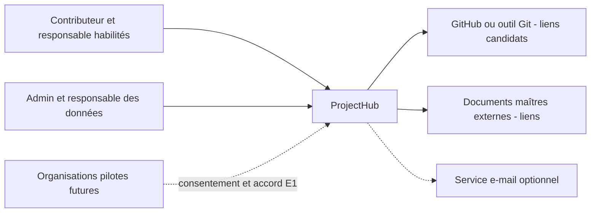
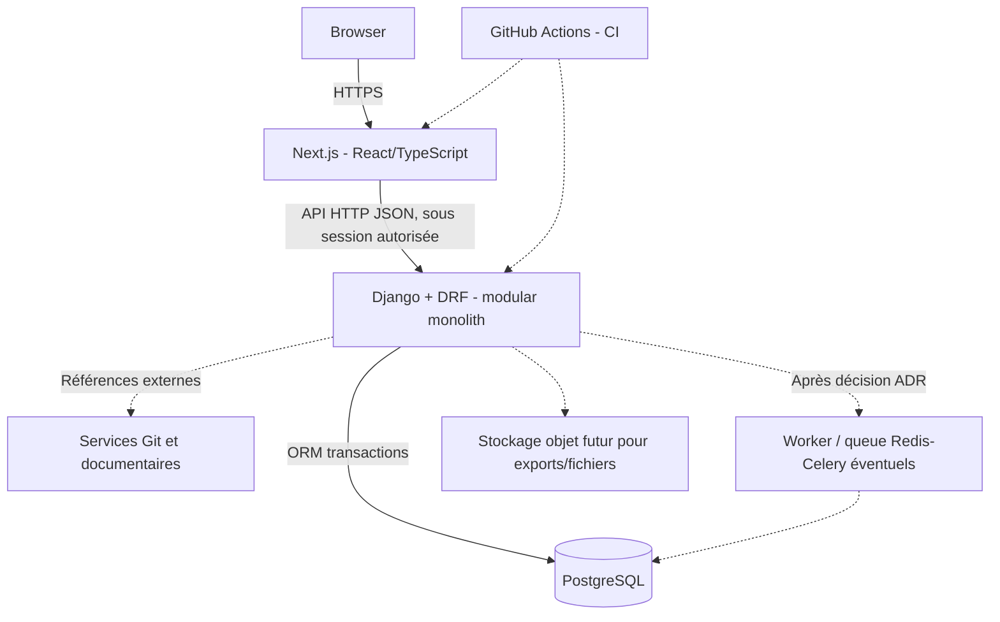
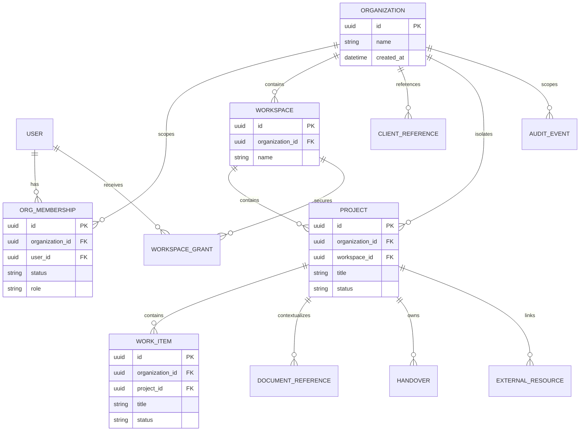
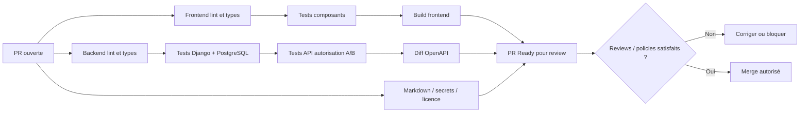
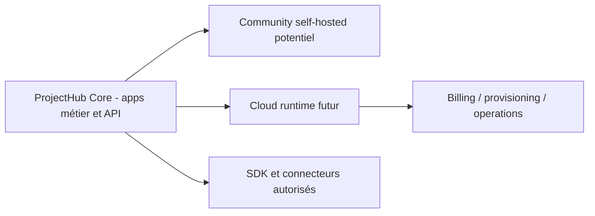

# ProjectHub Architecture & Engineering Baseline V1.0

**Édition interne exhaustive, datée du 21 novembre 2026.**

> **Lecture obligatoire.** Ce document est une **baseline de conception proposée** destinée à transformer la Discovery en décisions architecturales, contrats de code, standards d'ingénierie et plan d'implémentation E0. Il ne prouve pas qu'un backend, un frontend, des modèles, des tests, une infrastructure ou une offre SaaS fonctionnent déjà. Aucune recommandation ici ne clôt automatiquement une question `PH-OPEN`, une réserve `PH-REV`, un ADR ou une gate E1. Une version publique devra être relue et expurgée séparément.

**Navigation :** [1. Synthèse](#1-synthèse-exécutive-et-portes-de-décision) | [4. Architecture](#4-architecture-logique-et-c4) | [7. Modèle de données](#7-modèle-de-données-et-invariants) | [8. Permissions](#8-autorisation-rbac-et-identités) | [11. API](#11-api-rest-et-contrats-de-service) | [16. Qualité](#16-stratégie-de-tests-et-preuves) | [23. Plan E0](#23-plan-de-réalisation-du-premier-e0) | [27. ADR](#27-registre-dadr-candidats).

---

## 0. Métadonnées, conventions et niveaux de vérité

### 0.1. Objet du jalon

La **Discovery Baseline V1.0** a produit 25 éditions publiques structurées ; les PR documentaires sont fusionnées. Cette clôture **éditoriale** permet de commencer la conception technique, mais n'est pas une validation de besoins, de sécurité ou de valeur commerciale.

La présente **Architecture & Engineering Baseline V1.0** doit répondre de manière vérifiable à cinq questions :

1. Comment coder le **plus petit parcours métier E0** sans déployer les treize domaines complets ?
2. Comment garantir l'**isolation d'Organization** dans les lectures, écritures, exports, recherches, caches et tâches différées ?
3. Comment séparer **rôles applicatifs**, **grants effectifs** et **mandats métier** ?
4. Comment industrialiser des contributions Django/DRF + React/Next.js, de la PR au déploiement reproductible ?
5. Quelles preuves déclenchent un passage à l'étape suivante, sans confondre E0 et E1 ?

### 0.2. Légende des décisions

| Étiquette | Définition | Peut figurer comme acquis ? |
|---|---|---|
| `SRC` | Contrainte ou intention explicitement documentée dans la Discovery | Oui, comme **référence documentaire candidate** |
| `PROP` | Choix technique recommandé dans ce document | Non, doit passer en ADR |
| `DECIDED` | Décision écrite approuvée par l'autorité compétente | Oui, dans sa portée et sa version |
| `IMPLEMENTED` | Comportement présent sur un commit identifiable | Oui, sous réserve de preuve |
| `VERIFIED` | Test exécuté, environnement et résultat traçables | Oui, pour le seul scénario testé |
| `OPEN` | Arbitrage non réalisé | Non |
| `E0` | Démonstration à données synthétiques | Ne constitue pas une autorisation E1 |
| `E1` | Pilote réel conditionnel | **No-Go** tant que les gates et accords manquent |

Les termes **MUST / SHOULD / MAY** dans les sections techniques expriment un *standard proposé pour adoption*. Ils ne sont pas une preuve que le dépôt le respecte déjà.

### 0.3. Sources réellement consultées

Les sections métier, catalogues, IDs et réserves ci-dessous sont fondés sur les **documents publics présents dans `main`** du dépôt ProjectHub à la préparation du document. Ils ont été relus, notamment : contexte canonique, registre de décisions, 30 questions ouvertes, Requirements FR/NFR/BR, modèle et frontières Domain, définition et backlog MVP, plan de validation et revue de baseline.

Les exemples d'ORM, de routes et de pipelines sont des **propositions d'architecture supplémentaires** : ils ne figurent pas comme code validé dans ces sources. Les versions et standards externes sont à épingler au bootstrap à partir des documentations officielles ([Django](https://www.djangoproject.com/download/), [Next.js](https://nextjs.org/support-policy), [PostgreSQL](https://www.postgresql.org/docs/current/ddl-rowsecurity.html), [OWASP ASVS 5](https://asvs.owasp.org/)).

### 0.4. Règles de confidentialité

- Ne jamais copier dans GitHub public une identité, un chemin local, un nom de client non autorisé, une correspondance contractuelle, un incident, des verbatims ou des secrets issus d'un corpus privé.
- Les données de test E0 sont **synthétiques**, explicitement identifiables comme telles.
- Les références aux ID publics sont autorisées ; les tables de concordance privées doivent rester hors du dépôt.
- Tout exemple d'utilisateur, d'adresse, de domaine, de jeton et d'Organization est fictif ou paramétrique.
- Une *publication GitHub* n'est pas une *habilitation à traiter des données réelles*.

## 1. Synthèse exécutive et portes de décision

### 1.1. Vision technique proposée

**Recommendation `PROP-A01` :** un **monolithe modulaire Django + Django REST Framework** avec **PostgreSQL** comme source canonique, **Next.js/React + TypeScript** comme application web, **Docker Compose** pour la reproductibilité E0, **GitHub Actions** pour la CI et une séparation explicite entre **produit communautaire potentiel** et **opérations de Cloud commercial futures**.

La valeur de ce choix est la cohérence transactionnelle, la capacité de test et l'effort de maintenance initial, non une affirmation qu'il s'agit de la meilleure architecture pour toutes les phases. Une revue des alternatives est requise.

**Invariants prioritaires issus de Discovery :**

- `Organization -> Workspace -> Project -> WorkItem` : hiérarchie candidate fondamentale.
- `ClientReference != Organization`, `Team != Workspace`, `Project != GitRepository`.
- Un utilisateur peut posséder plusieurs memberships, **sans droit implicite entre tenants**.
- `ProjectLead` n'est pas un administrateur ni un approbateur métier.
- `governance` propriétaire proposé des décisions et risques, mais `PH-OPEN-003` **reste OPEN**.
- Les liens GitHub et documentaires ne transfèrent pas les ACL du système tiers.
- Une Handover préparée n'est pas une passation validée.
- Les vues, rapports et exports héritent des **droits des ressources sources**, pas d'un accès global.

### 1.2. Arbitrages structurants à faire approuver

| ID de chantier | Proposition actuelle | Alternative sérieuse | Décision requise avant |
|---|---|---|---|
| `A-01` | Monolithe modulaire | Microservices, monorepo multi-backends | Construction backend |
| `A-02` | PostgreSQL, schéma partagé, `organization_id` et contrôles serveur | Schéma/base par tenant, RLS complémentaire | `SLICE-00` |
| `A-03` | Policy service et permissions explicites, deny by default | RBAC permissif global | `SLICE-00` |
| `A-04` | Session same-origin/BFF et cookies sécurisés en déploiement | Tokens directement dans navigateur | Auth et front E0 |
| `A-05` | Contrats internes + transactions locales, outbox à la demande | Event bus précoce | Premiers événements |
| `A-06` | Table primaire, Board facultatif | Board premier / vues multiples | UX `SLICE-02` |
| `A-07` | Export CSV/JSON déterministe en E0 | Archivage complexe, sync bidirectionnelle | `SLICE-05` |
| `A-08` | Références externes seulement au départ | Intégration GitHub bidirectionnelle immédiate | `SLICE-03` |
| `A-09` | `governance` canonique des Decision/Risk | `workitems` canonique | Contrats Domain concernés |
| `A-10` | Distribution Community potentielle avec Cloud séparé | Open Core / mono SaaS | Licence et exploitation |

Aucun de ces dix points n'est automatiquement `DECIDED` par la rédaction du présent document.

### 1.3. Décision de jalon proposée

- **GO conditionnel :** travaux d'architecture, POC d'autorisations et développement **E0** sur données fictives après approbation des ADR bloquants.
- **NO-GO :** données réelles de pilotes, facturation commerciale opérationnelle et promesses de SLA avant preuves correspondantes.
- **Checkpoint obligatoire :** revue d'architecture avec décision écrite sur `PH-OPEN-002`, `003`, `006`, `016` et `020`.

## 2. Traçabilité Discovery -> Architecture -> Engineering

### 2.1. Vue des catalogues de référence

| Catalogue | Volume déclaré dans Discovery | Usage dans ce jalon |
|---|---:|---|
| `PH-XNEED-001..029` | 29 familles | Justification produit |
| `PH-REQ-001..130` | 130 FR candidates | Capacités et restrictions |
| `PH-NFR-001..113` | 113 NFR candidates | Quality attributes et gates |
| `PH-BR-001..111` | 111 règles candidates | Invariants et policies |
| `PH-TERM-001..145` | 145 termes | Vocabulaire canonique |
| `PH-DM-AGG-001..020` | 20 agrégats candidats | Modèle conceptuel |
| `PH-DM-REL-001..030` | 30 relations | Contraintes relationnelles |
| `PH-DM-CMD-001..020` | 20 commandes | Services applicatifs |
| `PH-DM-EVT-001..020` | 20 événements | Historique et projections |
| `PH-BC-001..032` | 32 contrats inter-domaines | Ports et collaborations |
| `PH-SCP-001..025` | 25 capacités de scope | Arbitrage MVP vs P1/P2 |
| `PH-BLG-001..045` | 45 items candidats | Plan de construction |
| `MVP-UJ-01..10` | 10 parcours | Tests E0 |
| `PH-REV-001..020` | 20 réserves | Risques de revue |

Les catalogues publics sont **synthétiques** ; ne pas présumer que chaque ID dispose d'une fiche intégralement accessible dans GitHub. Ne jamais inventer un test ou un statut d'implémentation pour combler une case.

### 2.2. Matrice de traçabilité architecturale critique

| Source | Exigence/invariant | Élément de conception | Test/trace exigé |
|---|---|---|---|
| `PH-REQ-001`, `PH-BR-001`, `PH-NFR-001` | Tenant vérifié | TenantContext + service d'autorisation | A ne lit pas B via API |
| `PH-REQ-021..022`, `PH-BR-002..004` | Parentage | FK et validations tenant | Child dans parent étranger refusé |
| `PH-REQ-010..013`, `PH-NFR-013` | Membership/révocation | Identity et cache d'autorisation court | Session révoquée rejetée |
| `PH-REQ-026`, `PH-BR-009` | Client ≠ tenant | ClientReference sans grant | Client de A ne lit pas B |
| `PH-REQ-038`, `050` | Project/WorkItem | Aggregate roots et services | Création et assignation autorisées |
| `PH-REQ-072`, `PH-NFR-006` | Vues | Scoped query + filtres | Sentinelle étrangère invisible |
| `PH-REQ-080` | Référence documentaire | DocumentReference minimal | Lien tiers sans permission transférée |
| `PH-REQ-082..083` | Handover vérifiable | Handover/AcceptanceState | Repreneur accomplit une action |
| `PH-REQ-094`, `PH-BR-063..073` | Mandat distinct des rôles | BusinessMandate policy | Admin non mandaté ne valide pas |
| `PH-REQ-004`, `PH-NFR-005`, `PH-BR-104..106` | Sortie maîtrisée | Export service + fichiers bornés | Aucun objet B dans export A |
| `PH-NFR-007`, `PH-BR-007` | Async context | Job envelope / revalidation | Job après révocation est refusé |
| `PH-NFR-049..058` | Continuité E1 | Backup/restore/rollback runbooks | Exercice daté E1 |

### 2.3. Gestion d'un lien de preuve

Le chemin attendu est : **source publique** -> **requirement** -> **ADR** -> **issue** -> **PR/commit** -> **test exécuté** -> **preuve** -> **décision de validation**. L'absence d'une étape doit être explicite (`NOT_RUN`, `BLOCKED`, `OPEN`, `NOT_APPLICABLE` justifié).

## 3. Principes, contraintes et anti-objectifs

### 3.1. Principes retenus comme standards candidats

1. **Security and tenant isolation by construction.** Chaque requête inclut un périmètre d'autorisation dérivé côté serveur.
2. **Deny by default.** Aucune lecture ou action implicitement globale.
3. **Single canonical owner per aggregate.** Un domaine possède la mutation ; d'autres lisent via contrat.
4. **Explicit operational seams.** Les exports, importations, intégrations et jobs sont des frontières sensibles.
5. **Thin controllers, rich application services.** Le serializer et la view ne décident pas seuls des règles métiers.
6. **Dependency direction visible.** Pas de cycles d'import entre apps.
7. **Contract-first enough.** OpenAPI, types TS, cas d'erreur et versionnement documentés.
8. **Simple before distributed.** Pas de broker, microservices ou moteur IA sans besoin démontré.
9. **Proof over status.** Un statut `done` n'est pas un test exécuté.
10. **Open source capable.** Pas d'obligation d'intégrer une configuration propriétaire pour faire tourner l'édition Community candidate.
11. **Accessibility in main path.** Navigation clavier, focus, contrastes et erreurs dès E0.
12. **Exit by design.** Un utilisateur peut récupérer son périmètre autorisé.

### 3.2. Contraintes et exclusions

- **Stack souhaitée** : Python, Django, DRF, React, Next.js, TypeScript, PostgreSQL ; Docker et GitHub Actions.
- **13 domaines cibles** à préserver dans la cartographie, mais pas nécessairement les 13 apps Django à coder au départ.
- **E0** : deux Organizations fictives ; aucune donnée privée provenant d'un client, d'une organisation ou d'un appareil personnel.
- **E1** : aucune mise à disposition avant accords et huit gates.
- **Hors MVP** : synchronisation Git avancée, GED, CRM, facturation Cloud, agents autonomes, orchestrateur générique, analytics prédictifs.
- **Pas de date, coût, benchmark, SLA ou certification inventés**.

## 4. Architecture logique et C4

### 4.1. C4 - contexte (niveau 1)



Les systèmes tiers sont **des sources maîtres distinctes**. Les flèches vers un service futur expriment une dépendance potentielle et non une intégration existante.

### 4.2. C4 - conteneurs (niveau 2)



**E0 minimal :** Next.js, Django/DRF et PostgreSQL ; fichiers de développement uniquement si besoin, sans en déduire une architecture de stockage de production.

### 4.3. Modes d'exploitation distincts

| Mode | Objectif | Données | Exigences techniques |
|---|---|---|---|
| Local Dev | Développer | Démo synthétique | Compose reproductible, tests |
| CI | Vérifier une PR | Fixtures synthétiques | Isolation, checks sans secrets |
| E0 Hosted Demo, optionnel | Faire voir le parcours | Uniquement synthétique | HTTPS, accès limité, TTL, purge |
| E1 Pilot | Usage réel autorisé | Minimisé et classifié | Huit gates E1 **satisfaites** |
| Community | Auto-hébergement futur | Contrôle de l'opérateur | Installation et upgrade documentés |
| Cloud | SaaS futur | Tenant isolé | Provisioning, billing, support, conformité |

Les exigences Cloud ne doivent pas devenir des dépendances bloquantes des parcours E0 locaux.

### 4.4. Gestion des défaillances

L'échec d'un lien GitHub n'empêche pas de consulter un Project ; un reporting indisponible ne casse pas une écriture de WorkItem ; un webhook répété ne provoque pas de mutation double ; une révocation est vérifiée avant qu'une tâche différée n'agisse.

## 5. Structuration du dépôt et modularité

### 5.1. Monorepo candidat

```text
projecthub/
├── README.md
├── LICENSE                     # À choisir et approuver, ne pas inventer
├── docs/
│   ├── 00-context/ ... 06-validation/
│   ├── 07-architecture/        # À créer après revue documentaire
│   │   ├── 00-architecture-engineering-baseline.md
│   │   ├── decisions/
│   │   ├── diagrams/
│   │   ├── api/
│   │   ├── security/
│   │   └── runbooks/
│   └── 08-engineering/         # Conventions, tests et guides
├── backend/
│   ├── manage.py
│   ├── pyproject.toml
│   ├── config/                 # settings, urls, asgi/wsgi
│   ├── apps/
│   │   ├── core/
│   │   ├── identity/
│   │   ├── organizations/
│   │   ├── portfolios/
│   │   ├── projects/
│   │   ├── workitems/
│   │   ├── planning/
│   │   ├── views/
│   │   ├── collaboration/
│   │   ├── governance/
│   │   ├── integrations/
│   │   ├── automation/
│   │   └── reporting/
│   └── tests/
├── frontend/
│   ├── package.json
│   ├── src/app/                # Next.js App Router, à valider
│   ├── src/features/
│   ├── src/components/
│   ├── src/lib/api/
│   └── tests/
├── packages/                  # Seulement si un partage réel apparaît
├── infra/
│   ├── compose/
│   ├── docker/
│   └── deployment/            # Après décision d'hébergement
├── scripts/
├── .github/
│   ├── workflows/
│   ├── ISSUE_TEMPLATE/
│   └── pull_request_template.md
├── compose.yaml
├── .env.example
├── Makefile
└── AGENTS.md                   # Consignes générales, sans secrets
```

**Ce tree est une cible proposée ; il ne décrit pas les fichiers déjà présents sur `main`.** Éviter de créer des répertoires vides ou des apps sans besoin, juste pour remplir l'arborescence.

### 5.2. Structure interne recommandée d'un domaine actif

```text
apps/workitems/
├── apps.py
├── models.py
├── migrations/
├── domain/               # invariants purs, types, validations
├── application/          # commands, queries, services
├── infrastructure/       # repository/adapters, si nécessaire
├── api/                  # views, serializers, permissions, routes
├── selectors.py          # lectures tenant-scoped, convention possible
└── tests/                # unit, API, policy, integration
```

Les interfaces abstraites ne sont utiles que si elles isolent une vraie dépendance ; ne pas créer une couche repository vide par réflexe. En Django, l'ORM peut rester l'adaptateur concret tant que les services ne traversent pas les bounded contexts de manière arbitraire.

### 5.3. Règles de dépendances

- `core` ne dépend d'aucun domaine métier.
- `organizations` fournit les contrats de tenancy ; `identity` fournit permissions et memberships ; leur bootstrap mutuel doit être conçu sans import circulaire.
- `projects` possède le Project ; `workitems` référence son ID et valide sa portée via contrat.
- `views` et `reporting` ne possèdent ni WorkItems ni Projects.
- `governance` ne modifie un WorkItem que via service/commande du propriétaire.
- `integrations` vérifie son tenant et n'accède pas directement aux credentials depuis les autres apps.
- `automation` appelle les services autorisés ; elle ne contourne jamais l'autorisation sous prétexte d'une identité technique.

## 6. Bounded contexts : propriété, phases et contrats

### 6.1. Inventaire canonique des 13 domaines

| Domaine | Propriétaire candidat | E0 | P1/P2 | Sensibilité |
|---|---|---|---|---|
| `core` | conventions, audit et outils communs | **Base** | export framework avancé | Audit et data access |
| `identity` | User, Membership, Grant | **Base** | Team, ServicePrincipal | Élevée |
| `organizations` | Organization, Workspace, ClientReference | **Base** | portefeuilles client avancés | Critique |
| `portfolios` | Portfolio, Program, thèmes | Non | **P1/P2** | Lecture cross-projets |
| `projects` | Project, Objective, Deliverable | **Base limitée** | gestion de livrables avancée | Élevée |
| `workitems` | WorkItem, assignation, blocages | **Base** | epics/bugs avancés | Élevée |
| `planning` | Milestone, phase, release | Version minimale éventuelle | **P1** | Moyenne |
| `views` | Table/Board et SavedView | **Table minimale** | Board/Roadmap/Calendar | Risque de fuite indirecte |
| `collaboration` | DocumentReference, Activity, Handover | **Base** | comments/files/meetings | Références sensibles |
| `governance` | Decision/Risk, approbation *proposée* | **Refus de mandat**, modèle simplifié | Workflow formel après ADR | Critique mandat |
| `integrations` | ExternalResource et connecteurs | **Liens uniquement** | GitHub sync future | Secrets et webhooks |
| `automation` | règles/agents/trigger | Non | P2 | Critique lorsqu'activée |
| `reporting` | définitions métriques et projections | Synthèse datée limitée | P1/P2 | Agrégats cross-tenant |

### 6.2. Collaborations clés

| Contrat source | Usage recommandé | Garantie |
|---|---|---|
| `PH-BC-003` | organizations -> projects | Workspace existant et autorisé |
| `PH-BC-005` | projects -> workitems | Project parent valide avant création |
| `PH-BC-006` | identity -> workitems | Acteur/assignee et permissions vérifiés |
| `PH-BC-007` | projects -> collaboration | Référence ou passation dans le bon tenant |
| `PH-BC-009..010` | projects/workitems -> views | Lecture filtrée par scope |
| `PH-BC-012` | core -> export orchestré | Export borné, audité, réversible |
| `PH-BC-015` | identity -> core | Révocation doit invalider droits/sessions |
| `PH-BC-020` | governance -> workitems | Lier action et décision sans fusionner les objets |
| `PH-BC-025` | integrations -> projects | Lien source externe sans grant |
| `PH-BC-027..028` | reporting | Indicateurs et risques sans pouvoir global |
| `PH-BC-029..031` | automation -> domaines | Cmd sous permission, approbation humaine si requise |

Ces relations ne prescrivent pas une dépendance Python dans le sens de leur libellé. Définir ports, consommateurs et propriétaires explicitement en ADR.

---
## 7. Modèle de données et invariants

### 7.1. Principes de modélisation

**Proposition `PROP-DATA-01` :** PostgreSQL à **schéma partagé** pour E0, avec `organization_id` sur les données tenant-scoped et une vérification explicite du parentage. Le tenant est **Organization**, pas Workspace. Une stratégie base/schéma par tenant pourrait être réévaluée pour un Cloud Enterprise futur, mais ne doit pas masquer l'obligation de vérifier les droits applicatifs.

Conventions proposées :

- Identifiants UUID, générés par serveur ; UUIDv4 est suffisant en E0. Tout choix UUIDv7/ULID requiert contrôle du support de la stack et un ADR.
- Horodatages avec fuseau en UTC côté serveur ; formats ISO 8601 dans l'API.
- `created_at`, `updated_at`, `created_by` selon importance ; horodatages métier distincts (`observed_at`, `verified_at`, `effective_at`).
- `organization_id` obligatoire pour chaque enregistrement tenant-scoped ; `workspace_id` lorsqu'une portée Workspace a un sens.
- `deleted_at` / soft delete **seulement** après décision de rétention, car le soft delete n'est pas une suppression RGPD.
- Éviter une clé `tenant_id` anonyme si le concept public est `Organization` : clarifier la correspondance dans les ADR.
- Pour les exports, garder un schéma documenté et un manifeste de provenance ; ne pas exporter les secrets ni les données d'autres tenants.

### 7.2. Schéma relationnel conceptuel minimal E0



`ORGANIZATION` est racine de confidentialité ; toutes les associations dans un tenant portent une preuve de cohérence. Le diagramme **n'est pas une migration exécutée**.

### 7.3. Tables candidates et responsabilités

| Table conceptuelle | Champs structurants | Invariants |
|---|---|---|
| `organization` | id, slug, name, lifecycle | Tenant unique, aucun accès implicite |
| `workspace` | id, organization_id, name, visibility | Parent Organization non nullable |
| `user` | id, username ou email, is_active | Compte ne signifie pas membership |
| `organization_membership` | user, organization, role, state, valid_from/to | Un état actif à scope cohérent |
| `workspace_grant` | user/membership, workspace, capabilities, state | Workspace et Organization cohérents |
| `team` / `team_membership` | org, users, label | Ne crée pas automatiquement d'ACL |
| `client_reference` | organization, code, label | Relation client sans nouveau tenant |
| `project` | organization, workspace, title, status, lead, backup | Tenant = tenant du Workspace |
| `objective` | project, description, success_criterion | Objectif distinct du ticket |
| `deliverable` | project, acceptance_state, accepted_by | Livraison != acceptation |
| `work_item` | organization, project, type, priority, state, assigned_to | Parentage + acteur autorisé |
| `work_item_dependency` | predecessor, successor, kind | Pas de cross-tenant, politique de cycle |
| `document_reference` | organization, project, url, title, source, visibility | URL non secrète, pas de droit tiers |
| `handover` | org, project, from, to, status, evidence | Prepared != validated |
| `external_resource` | organization, project, provider, external_id, url | Source externe maîtresse |
| `audit_event` | actor, organization, subject, action, timestamp, metadata | Immuabilité logique et minimisation |
| `export_request` | org, requester, scope, status, expiry, object_ref | Téléchargement sous nouveau contrôle |

Tables reportées : `portfolio`, `program`, `milestone` complet, `saved_view` avancé, `decision`, `risk`, `integration_credential`, `automation_rule`, `metric_snapshot`, sauf ADR explicitant une dépendance réelle de tranche E0.

### 7.4. Contraintes SQL essentielles

L'invariant **« enfant et parent appartiennent au même tenant »** ne peut pas être sécurisé uniquement par une validation dans un serializer. Exemple **conceptuel** de contrainte composite PostgreSQL :

```sql
-- Illustration d'invariant. Adapter noms de tables et migrations réelles.
ALTER TABLE organizations_workspace
  ADD CONSTRAINT workspace_org_id_pair UNIQUE (organization_id, id);

ALTER TABLE projects_project
  ADD CONSTRAINT project_workspace_same_org
  FOREIGN KEY (organization_id, workspace_id)
  REFERENCES organizations_workspace (organization_id, id);

ALTER TABLE projects_project
  ADD CONSTRAINT project_org_id_pair UNIQUE (organization_id, id);

ALTER TABLE workitems_workitem
  ADD CONSTRAINT workitem_project_same_org
  FOREIGN KEY (organization_id, project_id)
  REFERENCES projects_project (organization_id, id);
```

**À valider dans l'ADR** : l'ORM Django ne modélise pas toujours les FK composites nativement comme des `ForeignKey` standards ; leur ajout peut nécessiter `RunSQL` et des migrations testées. **Ne jamais copier cet SQL tel quel dans un environnement existant** sans vérifier noms, contraintes, indexes, migrations de retour arrière et cardinalités. Pour les tables non-tenant (User, référentiels globaux), les politiques sont différentes.

### 7.5. Contraintes supplémentaires candidates

- `UNIQUE (organization_id, slug)` pour les slugs de Workspace ou Project, selon UX retenue.
- `CHECK` ou validation contrôlée pour statuts autorisés, et validation métier des transitions.
- `CHECK` d'ordre temporel `valid_to >= valid_from` pour grants temporaires.
- Index `(organization_id, workspace_id, status, updated_at)` sur Projects si les requêtes le justifient.
- Index `(organization_id, project_id, status)` sur WorkItems.
- `UNIQUE` pour tokens d'invitation **hachés** et durée de validité ; jamais de jeton brut dans la DB ou les logs.
- Des contraintes à double clé pour chaque relation cross-aggregate portant un tenant : assignee éligible, références, handover, exports.
- Une table de journal technique ne doit pas conserver à elle seule des données personnelles indéfiniment.

### 7.6. PostgreSQL Row-Level Security (RLS)

**Option de défense en profondeur**, non remplacement des checks métier :

1. Protéger les tables tenant-scoped par policy et `FORCE ROW LEVEL SECURITY` si retenu.
2. Utiliser un rôle DB d'exécution **sans `BYPASSRLS`**, distinct du propriétaire des tables et du rôle migration.
3. Définir le contexte tenant dans la **transaction courante** via `SET LOCAL` après validation applicative et nettoyer systématiquement.
4. Évaluer les implications de pooling, transactions imbriquées, tâches asynchrones, superusers, migrations, requêtes brutes, commandes de gestion et exports.
5. Tester les requêtes hors contexte, le changement de tenant dans une session réutilisée, les transactions concurrentes et l'exécution de jobs.
6. Documenter le risque de faux sentiment de sûreté si le rôle de connexion contourne les policies.

Exemple conceptuel et **incomplet** :

```sql
-- Illustration uniquement : policy à compléter avec les droits propres à l'action.
ALTER TABLE projects_project ENABLE ROW LEVEL SECURITY;
ALTER TABLE projects_project FORCE ROW LEVEL SECURITY;
CREATE POLICY project_org_scope ON projects_project
  USING (organization_id::text = current_setting('app.organization_id', true));
```

**La colonne `organization_id` n'est pas une vérification de membership.** Le service applicatif doit authentifier l'acteur, dériver le tenant autorisé, vérifier l'opération et le mandat éventuel. Le SQL ci-dessus n'est pas un guide de production prêt à copier. Voir [documentation PostgreSQL RLS](https://www.postgresql.org/docs/current/ddl-rowsecurity.html).

### 7.7. Données historiques et migrations

- Séparer **observation** et **vérité courante** ; un statut importé hérite de sa date source.
- Refuser les migrations inter-tenant implicites et les `UPDATE organization_id` directs.
- Versionner migrations Django, tester sur BD vide et migrée, documenter rollback ou stratégie de compensation.
- Supprimer ou anonymiser les fixtures avant toute publication.
- Tester la remise à zéro du jeu E0 sans écraser une autre base par erreur.

## 8. Autorisation, RBAC et identités

### 8.1. Modèle d'acteurs proposé

| Concept | Rôle | Distinguer de |
|---|---|---|
| `User` | Identité authentifiée | Person, rôle métier |
| `OrganizationMembership` | Lien actif dans un tenant | Droit global |
| `WorkspaceGrant` | Capacité explicite sur Workspace | Simple appartenance Team |
| `ProjectGrant`, si nécessaire | Exception de portée Project | ProjectLead |
| `Role` | Collection d'actions dans un scope | Autorité de décision métier |
| `BusinessMandate` | Autorité explicite d'accepter/décider | OrgAdmin |
| `ServicePrincipal` | Identité technique bornée, future | Superuser implicite |

**Décision ouverte :** granularité Project et inheritance des rôles (`PH-OPEN-002`). Pour E0, privilégier peu de rôles mais des permissions serveur explicites, et tests de refus.

### 8.2. Rôles E0 candidats (à valider)

| Rôle | Étendue candidate | Actions par défaut | Refus explicitement attendu |
|---|---|---|---|
| `OrgOwner` | Organization | Administrer membres et politique tenant | Approbation métier sans mandat |
| `OrgAdmin` | Organization | Gestion administrative contrôlée | Lecture d'un autre tenant |
| `WorkspaceAdmin` | Workspace | Gérer membres/ressources de Workspace | Accès à Workspace privé voisin |
| `ProjectContributor` | Project/Workspace | Lire et modifier travail autorisé | Modifier un autre Project sans grant |
| `WorkspaceViewer` | Workspace | Lecture autorisée | Toute écriture |
| `DecisionAuthority` | Scope et objet explicites | Approuver un acte métier désigné | Autorité globale sur tous les actes |

`ProjectLead` et `Substitute` sont **des responsabilités métier**, non des rôles équivalents. Une organisation peut imposer des règles supplémentaires pour autoriser la modification, la délégation et l'acceptation.

### 8.3. Algorithme d'autorisation (pseudo-code)

```python
# Pseudo-code conceptuel, pas un module prêt à copier.
def authorize(actor, action, resource, tenant_context):
    if not actor.is_authenticated:
        raise Unauthenticated()
    org = resolve_validated_organization(tenant_context, actor)
    membership = get_active_membership(actor, org)
    if not membership:
        raise Forbidden()
    if resource is not None and resource.organization_id != org.id:
        raise ConcealedNotFound()   # selon politique de non-divulgation
    scope = resolve_effective_scopes(membership, resource)
    if not capability_allows(action, scope):
        raise Forbidden()
    if requires_business_mandate(action):
        assert_active_mandate(actor, action, resource, org)
    return AuthorizedContext(actor=actor, organization=org, scopes=scope)
```

**Interdit** : faire confiance à un simple `organization_id` envoyé par le navigateur ; traiter un `user.is_staff` Django comme permission de lecture tenant ; se reposer sur le filtrage de l'interface ; auto-octroyer un grant en étant indiqué `ProjectLead` ; créer un accès en attachant un `ClientReference`.

### 8.4. Ordre de contrôle d'une requête

1. Authentifier la session, vérifier activité et éventuelle expiration.
2. Vérifier l'origine et CSRF pour les mutations basées sur cookie.
3. Dériver et vérifier Organization actif, **ne pas le déduire seulement d'un slug visible**.
4. Vérifier membership et grants en vigueur au moment de l'acte.
5. Vérifier le parentage de la ressource et ses effets secondaires.
6. Vérifier permission d'action et, le cas échéant, mandat métier.
7. Exécuter la commande transactionnelle auprès du propriétaire du domaine.
8. Émettre un audit minimal sans secret, enregistrer le résultat et sa portée.

### 8.5. Matrice d'autorisation E0 indicative

| Ressource / action | Viewer | Contributor | WorkspaceAdmin | OrgAdmin | Mandataire métier |
|---|---|---|---|---|---|
| List Projects autorisés | Oui | Oui | Oui, selon Workspace | Selon politique | Selon grant |
| Create Project | Non | Selon grant | À valider | À valider | Aucun droit déduit |
| Edit WorkItem assigné | Non | Selon grant | Selon règle | Selon règle | Selon grant |
| Invite member | Non | Non | Selon règle | Selon règle | Non par défaut |
| Revoke membership | Non | Non | Sous conditions | Sous conditions | Non par défaut |
| Export Workspace | Non par défaut | Sur grant dédié | Selon politique | Selon politique | Non par défaut |
| Accept Deliverable | Non | Non | Non automatique | Non automatique | **Oui, dans le mandat** |
| Read Organization B | **Non** | **Non** | **Non** | **Non** | **Non** |

Toute cellule « selon politique » doit être formalisée avant implémentation : **ce n'est pas une permission accordée**.

### 8.6. Menaces et tests de révocation

- Une invitation non acceptée ne constitue pas un membership effectif.
- Après révocation, aucun accès par route, recherche, API, export, ancienne session, tâche en file ou cookie conservé.
- Il faut définir si la désactivation d'un membre entraîne révocation de sessions, tokens, grants descendants et capacités déjà déléguées.
- Prévenir la révocation du **dernier OrgOwner**, sauf procédure de récupération explicitement approuvée.
- Les données historiques peuvent rester attribuées à une identité révoquée, sous politique de confidentialité/rétention.
- Une personne membre de A et B voit des ressources différentes selon le contexte actif ; la bascule ne transporte pas les filtres ni résultats du tenant précédent.

### 8.7. Django admin et superusers

Le site `/admin/` n'est pas la console multi-tenant métier. Restreindre son accès, prévoir séparation des rôles techniques et accès de support temporaire justifié, avec journalisation. Le fait qu'un compte ait `is_superuser=True` ne doit jamais être la règle générique pour agir au nom d'une organisation E1. E0 doit tester un utilisateur **sans** superuser.

## 9. Authentification, sessions et sécurité du navigateur

### 9.1. Proposition de flux Web

Pour E0, privilégier un flux session/cookie **same-origin via reverse proxy ou BFF explicite** :

```text
Browser -> Next.js / gateway same-origin -> Django / DRF
   |            |
   |            -> UI et route protégée
   -> cookie HttpOnly Secure SameSite adapté
Django -> session stockée côté serveur -> membership évalué
```

**ADR obligatoire :** choisir précisément qui émet la session, comment Next.js la relaie, où vit CSRF et si l'API est same-origin ou cross-origin. Le mot « BFF » n'est pas une protection automatique ; un proxy mal configuré peut divulguer des cookies. Pour les requêtes mutantes, protéger CSRF et ne pas désactiver le contrôle pour simplifier un prototype.

### 9.2. Contre-exemples à exclure

- Jetons longue durée ou refresh tokens persistés en `localStorage` sans modèle de menace.
- Cookie sensible lisible par JavaScript lorsqu'il peut être HttpOnly.
- `CORS_ALLOW_ALL_ORIGINS=True`, `ALLOWED_HOSTS=['*']`, `DEBUG=True` dans un déploiement accessible.
- `SECRET_KEY` réel commité ou documenté en dur.
- Endpoint public acceptant `user_id`, `role` ou `organization_id` comme preuve suffisante de droits.
- Supposer que SSR/Server Components bloque à lui seul les lectures d'autres tenants.

### 9.3. Options d'identité futures

OIDC/SSO, MFA, SAML Enterprise, invitation e-mail, SCIM, clés d'API, OAuth GitHub et ServicePrincipals sont des **extensions distinctes**. Vérifier coût, maintenance, gestion de sessions et scopes avant adoption. Aucun des mécanismes n'est annoncé opérationnel.

## 10. Backend Django/DRF : design et règles de code

### 10.1. Stack recommandée à épingler

- Python : version stable supportée par Django et bibliothèques retenues.
- Django : version maintenue **épinglée** selon tableau officiel, ne pas laisser de plage flottante en production.
- Django REST Framework : version compatible avec Django et Python retenus.
- PostgreSQL : version maintenue, migrations et drivers testés.
- `pytest`/`pytest-django`, `ruff`, vérificateur de types (si applicable), `coverage`, scanner de dépendances.
- Configuration par environnement et validation au démarrage ; `pyproject.toml` et lockfile/version pinning.

**Important :** la source officielle Django décrit des versions stables/LTS et une politique de support évolutive. Ce document ne fige pas de numéro sans une matrice de compatibilité testée dans un ADR.

### 10.2. Quatre couches pertinentes

| Couche | Contient | Ne doit pas contenir |
|---|---|---|
| Domain | Invariants, valeurs et transitions | Accès direct à des API externes |
| Application | Commandes, contrôles d'accès, orchestration transactionnelle | Autorisation implicite ou SQL ad hoc cross-domain |
| Infrastructure | ORM, adaptateurs, mail, stockage, jobs | Règles de mandat dispersées |
| API | Serializers, routes, pagination, transformation des erreurs | Mutations qui contournent Application |

Django n'impose pas ce découpage : l'adopter **avec pragmatisme** pour les domaines réellement actifs.

### 10.3. Services de mutation

```python
# Exemple de contrat, volontairement incomplet.
@dataclass(frozen=True)
class CreateWorkItemCommand:
    project_id: UUID
    title: str
    assignee_id: UUID | None

@transaction.atomic
def create_work_item(command: CreateWorkItemCommand, context: AuthorizedContext):
    project = get_project_scoped(context.organization.id, command.project_id)
    require(context, "workitem:create", project)
    validate_assignee_in_scope(context, command.assignee_id, project)
    item = WorkItem.objects.create(
        organization_id=context.organization.id,
        project_id=project.id,
        title=command.title,
        assigned_to_id=command.assignee_id,
    )
    record_audit(context, "workitem.created", item)
    return item
```

Les imports, managers, états, erreurs, transaction et classes ne sont **pas fournis** ici ; c'est un exemple de disposition des vérifications et non du code exécutable.

### 10.4. Managers et QuerySets scoped

- Les listes utilisent un `for_actor(context)` ou un service de lecture explicitement **tenant-scoped**.
- Les détails recherchent un objet dans le périmètre autorisé **avant** de le modifier.
- Les fonctions génériques `get_object_or_404(Model, pk=id)` sans scope doivent être interdites pour les modèles tenant-scoped.
- Les filtres de recherche, compteurs, agrégats, analytics et exports doivent être filtrés **avant calcul**.
- Les endpoints d'administration technique qui nécessitent un accès global suivent un autre processus explicitement audité.

### 10.5. Validation, transactions et concurrence

- Préférer une transaction atomique pour commande + audit transactionnel.
- Évaluer `select_for_update` pour modifications concurrentes de membres, approbations ou statuts critiques.
- Pour les éditions simultanées de Project et WorkItem, envisager une colonne `version` et un conflit `409 Conflict` ou un ETag avec `If-Match`.
- Ne pas appeler des services externes lents dans une transaction DB longue ; réconcilier via job ou outbox après commit.
- Les retries doivent être idempotents ou identifier explicitement le risque de doublon.

### 10.6. Événements et audit

En E0, l'historique indispensable peut être inscrit **dans la même transaction** que la mutation ; un bus d'événements est différé. Si des projections asynchrones deviennent nécessaires, adopter une **outbox transactionnelle** et un consommateur idempotent avant de promettre une livraison fiable. Un événement métier ne transporte jamais un jeton, une pièce jointe confidentielle ou une permission implicite.

### 10.7. Migration et compatibilité

Les migrations Django sont relues comme du code sensible. Prévoir : migration avant/après, synchronisation de workers, passage de schéma compatible pour déploiement progressif, contraintes de FK, index et sauvegarde avant migration E1. Un rollback de schéma n'est pas toujours possible après une migration destructrice : documenter la procédure de récupération.

---
## 11. API REST et contrats de service

### 11.1. Principes

**API-first, versionnée, autorisée à chaque requête.** Première convention proposée : `/api/v1/`. Utiliser JSON, champs et erreurs documentés via OpenAPI, validation stricte, limites de pagination, et identifiants stables. Le schéma OpenAPI doit être généré depuis DRF puis contrôlé en CI ; le frontend ne doit pas inventer son contrat propre.

### 11.2. Endpoints E0 candidats

| Verbe | Route proposée | Résultat métier | Contrôle critique |
|---|---|---|---|
| GET | `/api/v1/me/` | Identité et contexte | Ne révèle que le sujet |
| GET | `/api/v1/organizations/` | Tenants accessibles | Membership actif |
| POST | `/api/v1/organizations/{org_id}/workspaces/` | Créer Workspace | Permission de création scoped |
| GET | `/api/v1/organizations/{org_id}/workspaces/` | Lister Workspaces autorisés | Scope au niveau de l'Organization |
| GET | `/api/v1/workspaces/{workspace_id}/projects/` | Projets du Workspace | Tenant et grant vérifiés |
| POST | `/api/v1/workspaces/{workspace_id}/projects/` | Créer Project | Workspace parent autorisé |
| GET | `/api/v1/projects/{project_id}/` | Fiche Project | Detail lookup tenant-scoped |
| PATCH | `/api/v1/projects/{project_id}/` | Modifier Project | Autorisation + version |
| GET | `/api/v1/projects/{project_id}/workitems/` | Travail accessible | Parent, état, pagination |
| POST | `/api/v1/projects/{project_id}/workitems/` | Créer WorkItem | Assignee et tenant cohérents |
| PATCH | `/api/v1/workitems/{item_id}/` | Mettre à jour | Transitions et permissions |
| GET | `/api/v1/projects/{project_id}/activity/` | Historique | Aucune fuite de champ |
| POST | `/api/v1/projects/{project_id}/references/` | DocumentReference | Aucun jeton dans URL |
| GET | `/api/v1/projects/{project_id}/handover/` | Dossier de passation | Participants autorisés |
| POST | `/api/v1/projects/{project_id}/handovers/` | Préparer passation | Préparation != validation |
| POST | `/api/v1/organizations/{org_id}/exports/` | Demander export | Permission d'export dédiée |
| GET | `/api/v1/exports/{export_id}/` | Statut export | Revalidation du requester |
| GET | `/api/v1/exports/{export_id}/download/` | Récupération | Revalidation à chaque téléchargement |

L'authentification, les invitations et les mutations de membership nécessitent des endpoints dédiés dont la surface exacte dépend de l'ADR Auth. **Les routes ci-dessus sont un inventaire à spécifier, pas un contrat approuvé.**

### 11.3. Exemple de requête/réponse

```http
POST /api/v1/projects/00000000-0000-4000-8000-000000000101/workitems/
Content-Type: application/json
Idempotency-Key: demo-request-001

{
  "title": "Préparer la revue fictive",
  "priority": "medium",
  "assignee_id": null
}
```

```json
{
  "id": "00000000-0000-4000-8000-000000000201",
  "project_id": "00000000-0000-4000-8000-000000000101",
  "title": "Préparer la revue fictive",
  "status": "todo",
  "priority": "medium",
  "assignee_id": null,
  "created_at": "2026-11-21T00:00:00Z"
}
```

Les UUID et horodatages sont **fictifs**. La prise en charge réelle de `Idempotency-Key` dépend d'une décision d'implémentation et d'un stockage anti-doublon ; ne pas annoncer la garantie avant son test.

### 11.4. Erreurs homogènes

Proposition : **Problem Details** ou contrat équivalent stable, documenté dans OpenAPI :

```json
{
  "type": "https://example.invalid/problems/not-found",
  "title": "Resource unavailable",
  "status": 404,
  "code": "RESOURCE_UNAVAILABLE",
  "request_id": "synthetic-request-id"
}
```

Politique indicative : `400` charge invalide, `401` non authentifié, `403` refus de capacité, `404` ressource absente **ou masquée** dans un autre tenant, `409` conflit d'état/version, `422` validation sémantique si adoptée, `429` limitation du débit, `5xx` erreur serveur sans détails sensibles. **Ne pas exposer via les messages d'erreur l'existence d'un tenant étranger.**

### 11.5. Filtrage, recherche et pagination

- Whitelist des champs filtrables et triables, jamais un nom de colonne libre.
- Limite de page et timeout, index évalués avec jeux volumineux fictifs.
- Les compteurs sont filtrés **après authorization du contexte, avant agrégation**.
- Un curseur peut être adopté pour flux d'activité ; pagination simple acceptée pour petit E0 si cohérente.
- Rechercher par titre n'autorise pas une recherche tous-tenants.
- Les liens externes sont validés et échappés ; éviter SSRF si un système serveur doit résoudre des URL.

### 11.6. Concurrence, idempotence et compatibilité

Une opération `PATCH` sur statut critique devrait inclure une version ou ETag. Une commande asynchrone ou export doit posséder un identifiant de corrélation et un mécanisme contre l'exécution double. Maintenir une politique de compatibilité versionnée : ajout de champs non obligatoire, dépréciation annoncée, pas de suppression silencieuse de champs consommés. Les changements de permission sont traités comme des modifications de contrat **sensibles**, même sans changement de route.

### 11.7. Publication OpenAPI et TypeScript

1. Générer le schéma OpenAPI depuis le backend.
2. Vérifier qu'aucune endpoint d'administration ou donnée de secret n'est exposé.
3. Contrôler format et compatibilité du diff OpenAPI en PR.
4. Générer des types TypeScript à partir du schéma épinglé.
5. Exécuter une suite de contrats HTTP sur le backend réel E0.
6. Épingler la version du générateur et du schéma pour que les diffs soient reproductibles.

## 12. Frontend Next.js/React/TypeScript

### 12.1. Architecture UI proposée

```text
frontend/src/
├── app/
│   ├── (public)/                 # accueil et connexion
│   ├── (app)/
│   │   ├── organizations/
│   │   ├── workspaces/
│   │   ├── projects/
│   │   └── settings/
│   ├── layout.tsx
│   └── error.tsx
├── features/
│   ├── auth-and-context/
│   ├── organizations/
│   ├── projects/
│   ├── workitems/
│   ├── collaboration/
│   └── exports/
├── components/
│   ├── ui/
│   ├── layout/
│   └── accessibility/
├── lib/
│   ├── api/                      # client généré ou typé
│   ├── permissions/              # présentation uniquement
│   └── format/
└── tests/
```

Le routage exact doit être choisi selon les besoins de deep links et de cache ; l'App Router est une hypothèse technique plausible, **pas une obligation déduite de Discovery**.

### 12.2. Flux de données

- Server Components pour les lectures adaptées au serveur ; composants client uniquement pour interactions nécessaires.
- Les données retournées au navigateur sont **déjà filtrées côté backend**.
- Les boutons masqués par le frontend améliorent l'UX mais **n'établissent pas les permissions**.
- Après changement de tenant, vider/partitionner les caches côté client, annuler les requêtes pendantes et invalider les listes précédentes.
- Clés de cache client de forme `['organization', organizationId, 'workspace', workspaceId, resource]` sans réutilisation entre tenants ; les données sensibles ne doivent pas survivre à une déconnexion.
- Prévoir états de chargement, erreurs, listages vides, informations périmées et perte de connexion.

### 12.3. Pages E0 et parcours

| Écran | Données | Parcours |
|---|---|---|
| Connexion / contexte | organizations et memberships autorisés | `MVP-UJ-01` |
| Workspaces | structure et accès | `MVP-UJ-01`, `10` |
| Table Projects | titre, objectif, responsable, état daté | `MVP-UJ-02`, `04` |
| Fiche Project | objectifs, refs, actions, activité | `MVP-UJ-02..05` |
| Table WorkItems | état, assignee, priorité, blocage | `MVP-UJ-03` |
| Handover | dossier, successeur, preuve | `MVP-UJ-06` |
| Membres et révocation | état des membres et grants | `MVP-UJ-07` |
| Export et sortie | demande, statut, téléchargement | `MVP-UJ-08` |
| Actions refusées | refus compréhensible sans fuite | `MVP-UJ-09` |

### 12.4. Accessibilité et design system minimal

- Utiliser HTML sémantique, labels associés et commandes atteignables au clavier.
- Vérifier le focus visible, l'ordre de tabulation et les dialogues accessibles.
- Les états et priorités ne doivent pas reposer sur la couleur seule.
- Fournir le contraste, les messages d'erreur actionnables et la possibilité d'augmenter le zoom.
- Tester les tables volumineuses, les champs facultatifs, les dates et le langage non technique.
- Appliquer les versions/référentiels WCAG retenus par décision, avec audit de parcours ; **ne pas revendiquer une conformité sans test**.

### 12.5. Sécurité du rendu et du cache

- Pas de secret ni token dans `NEXT_PUBLIC_*`.
- Protection XSS via escaping React et politique CSP adaptée ; HTML libre uniquement après sanitation validée.
- Politique de redirections et URL externes, éviter les open redirects.
- Pas de données tenant-scoped dans des pages statiques partagées, caches serveur globaux ou réponses CDN sans une stratégie sûre.
- Évaluer SSRF et cache poisoning des images externes, previews et fetch serveur.
- Erreurs Next.js et logs SSR sans fuite de cookies, headers ni metadata privées.

## 13. Collaboration, activité, passation et export

### 13.1. Références documentaires

`DocumentReference` porte minimalement `organization_id`, `project_id`, `label`, `source_type`, `url`, `source_owner`, `verified_at?` et `classification`. Une URL ne constitue pas un document importé. Afficher un avertissement de disponibilité et ne pas promettre une consultation si les droits du système externe ne sont pas accordés.

### 13.2. Historique/audit : différence à conserver

- **ActivityEvent** : événement affichable aux personnes autorisées, utile pour comprendre un travail.
- **AuditEvent** : trace sensible, plus restreinte, servant à investigation et preuve, sans nécessairement afficher tous les champs de mutation.
- **DomainEvent** : notification de changement métier destinée à un contrat, pas forcément stockée indéfiniment.

Les événements devraient comporter `actor`, `organization`, `resource`, `action`, `recorded_at`, `request_id`, `source` et classification. Éviter de conserver le payload intégral d'un WorkItem ou d'un document sans justification.

### 13.3. États candidats de passation

```text
DRAFT -> PREPARED -> OFFERED -> ACCEPTED_BY_SUCCESSOR
                           |           |
                           v           v
                        BLOCKED    VERIFIED_WITH_EVIDENCE
```

Le graphe est **une proposition** ; le droit de transition, l'acteur de validation et les états définitifs doivent être choisis avec le métier (`PH-OPEN-024`). **L'acceptation d'un dossier ne prouve pas la reprise**. Prévoir `next_action`, `attempt_result`, `observed_at`, `witness`, `reservations` et `evidence_ref` si des essais sont réalisés.

### 13.4. Contrat export E0

Proposition d'archive `projecthub-export-v1.zip` contenant, selon droits :

```text
manifest.json             # version schema, tenant, date, filtres, hashes
organizations.json        # données non secrètes accessibles
workspaces.json
projects.json
workitems.json
document_references.json  # liens, pas copie des documents
handovers.json            # sans pièces sensibles non autorisées
README.txt                # comment lire et limites
```

Les exports doivent être construits sur des requêtes tenant-scoped, avec une stratégie de fichiers temporaires, checksum, expiration, permission de téléchargement **réévaluée**, quotas, protection contre injection CSV (si CSV) et suppression des artefacts temporaires. Un export n'est pas un effacement ; le processus d'effacement/rétention E1 reste à décider.

## 14. Intégrations, automation et reporting

### 14.1. Première intégration GitHub : trois niveaux à distinguer

| Niveau | Fonction | Phase recommandée |
|---|---|---|
| L0 | Conserver lien de repository, issue, PR ou release | E0 facultatif |
| L1 | Lire métadonnées via OAuth/GitHub App avec scopes minimaux | P1 après besoin confirmé |
| L2 | Synchroniser ou muter des items et statuts dans les deux sens | P2, uniquement avec stratégie de conflit |

**Choix recommandé : L0 d'abord.** Le `Project` reste un objet métier et `Repository` une ressource externe. Un projet peut référencer plusieurs dépôts ; un dépôt peut intervenir dans plusieurs contextes sans donner un droit de lecture aux organisations concernées.

### 14.2. Protocole pour un connecteur futur

- Configuration et credentials possédés par `integrations`, sous tenant.
- Scopes minimaux, tokens chiffrés par gestionnaire de secrets, rotation et révocation.
- Webhook : signature vérifiée sur **raw body**, anti-rejeu, TTL, mappage du tenant et idempotence.
- Polling éventuel borné par rate limits, backoff, journal des erreurs et dernier sync time.
- Politique de source de vérité et de conflits avant toute écriture vers GitHub/GitLab/Jira/Azure DevOps.
- Pas de permission dérivée de la visibilité d'un lien externe.
- Toute donnée importée est marquée comme **source externe**, avec provenance et fraîcheur.

### 14.3. Automation et agents IA : reportés

Le `automation` cible dispose de règles, déclencheurs et identités techniques, mais le MVP E0 ne requiert pas de moteur d'agent. Quand un agent est introduit, imposer action autorisée, journal d'exécution, périmètre de données, budget, rollback, révocation et **approbation humaine pour les actes métiers sensibles**. Une décision d'approbation ne doit pas être prise uniquement parce qu'un service peut exécuter un endpoint.

### 14.4. Reporting minimal

Le premier rapport peut se limiter aux **compteurs explicables** : Projects visibles, WorkItems ouverts, bloqués et récents. Chaque indicateur doit préciser tenant, filtres, date de calcul, source et éventuelle incomplétude. Jamais de total calculé sur toutes les Organizations puis filtré par présentation.

## 15. Sécurité applicative et modèle de menaces

### 15.1. Actifs à protéger

- Identité, sessions et memberships.
- Projets et WorkItems tenant-scoped.
- Mandats de décision et historique de passation.
- Exports, fichiers temporaires, documents et références externes.
- Secrets d'intégrations et clés d'application.
- Traces d'audit, logs et métriques pouvant contenir indirectement des données sensibles.

### 15.2. Tableau des menaces prioritaires

| Menace | Surface | Risque | Mesure candidate | Test E0 |
|---|---|---|---|---|
| BOLA / IDOR | Detail API | Fuite de Project B à A | Scoped lookup + policy | GET/PATCH avec UUID étranger |
| BFLA | Endpoints d'administration | Auto-octroi de droits | Role + action scope | OrgMember appelle revoke |
| Cross-tenant join | SQL/projections | Fuite indirecte | Contraintes et filtres | Rechercher/count sentinelles B |
| Cache bleed | Browser, SSR, Redis | Résultat B montré à A | Partitionnement, invalidation | Bascules répétées A/B |
| Session fixation/reuse | Cookie/session | Ancien membre actif | Rotation, revoke et TTL | Session après revoke |
| CSRF | Mutation cookie | Action à l'insu de l'utilisateur | CSRF + SameSite + Origin | Mutation sans jeton valide |
| XSS | Titres, commentaires | Vol de session ou action | Encoding, CSP | Payload HTML en titre |
| SSRF | Liens, prévisualisations | Accès interne serveur | Validation URL et egress | URL vers IP privée |
| Webhook spoofing | Connecteurs futurs | Mutation non autorisée | Signature, mapping et idempotence | Signature invalide/replay |
| Secret leak | Code, logs, exports | Compromission | Secret manager, redaction | Fixture contenant sentinelle |
| Export cross-scope | Archive ou presigned URL | Fuite durable | Policy et revalidation | Télécharger export B |
| Supply chain | Dependencies/CI | Exécution malveillante | Lockfile, revue et provenance | Scan, actions épinglées |
| Privileged job | Worker | Contournement ACL | Envelope et revalidation | Revoke avant exécution |
| Broken retention | Data warehouse/backups | Conservation excessive | Rétention documentée | Purge et restauration contrôlée |

### 15.3. Standards de référence

- **OWASP ASVS 5.0.0** pour structurer les exigences de vérification : <https://asvs.owasp.org/>.
- OWASP API Security Top 10 pour les menaces BOLA et permissions API : <https://owasp.org/API-Security/>.
- Django Security documentation pour configuration et durcissement : <https://docs.djangoproject.com/en/stable/topics/security/>.
- PostgreSQL RLS, configuration et rôles : <https://www.postgresql.org/docs/current/ddl-rowsecurity.html>.

Un contrôle « GitGuardian green » est utile, **mais ne prouve pas qu'aucun document n'expose d'information confidentielle**. Une évaluation ASVS documentée n'autorise pas à revendiquer une certification officielle d'OWASP.

### 15.4. Baseline de configuration pour E0 hébergé

- HTTPS et reverse proxy correctement configurés.
- `DEBUG=False` et secrets injectés hors dépôt.
- Hosts, CORS, CSRF, cookies, headers de sécurité et proxy settings explicitement configurés.
- Une base dédiée E0 avec données synthétiques, accès et cycle de vie contrôlés.
- Sauvegarde ou stratégie de recréation de démonstration proportionnée, jamais présentée comme une restauration de données E1.
- Logs structurés, sans tokens et sans contenu métier sensible par défaut.
- Dépendances et images scannées, permissions des jobs CI minimales.

### 15.5. Réponse à incident et signalement

Avant E1, définir contacts et niveaux de gravité, confinement, rotation de secrets, restauration, communication, journal de décisions et obligation d'information selon les faits et le cadre légal. Aucune promesse d'astreinte 24/7 n'est justifiée au stade E0.

---
## 16. Stratégie de tests et preuves

### 16.1. Pyramide et critères de qualité

| Niveau | Rôle | Exemple | Gate |
|---|---|---|---|
| Unit - Domain | Vérifier invariants purs | Transition WorkItem | PR |
| Unit - Application | Vérifier commandes et politiques | CreateProject refusé | PR |
| Integration - DB | Vérifier ORM, FK, migrations | WorkItem de B sur Project A | PR |
| API Contract | Vérifier HTTP, sérialisation, OpenAPI | `404` sur UUID étranger | PR |
| Frontend component | Vérifier interaction et accessibilité | Changement de contexte | PR |
| End-to-end | Vérifier parcours complet | `MVP-UJ-02 -> 03` | E0 |
| Security negative | Chercher contournements | 2 Organizations, IDOR, export | PR/E0 |
| Operations exercise | Vérifier récupération et exploitation | Restore et rollback | **E1** |
| User observation | Vérifier compréhension et valeur | Successeur réalise tâche | E0, puis pilote autorisé |

**Aucun seuil numérique de couverture ou de performance ne doit être inventé comme fait acquis.** Définir des seuils cibles par risque dans l'ADR Qualité, puis mesurer la baseline réelle. La couverture est un signal, jamais une preuve suffisante.

### 16.2. Test matrices : personnes et tenants

| Acteur synthétique | Org A | Org B | Cible de test |
|---|---|---|---|
| `alice_a` | Member actif | Aucun grant | Doit voir A, jamais B |
| `bob_b` | Aucun grant | Member actif | Doit voir B, jamais A |
| `camille_ab` | Member actif | Member actif | Bascule A/B sans mélange |
| `dana_revoked` | Membership révoqué | Aucun | Toutes les lectures/écritures refusées |
| `erin_viewer` | Read-only dans un Workspace A | Aucun | Toutes mutations refusées |
| `fran_admin` | OrgAdmin A | Aucun | Admin de A sans mandat ni accès B |
| `grace_mandated` | Mandat ciblé dans A | Aucun | Approbation ciblée, pas globale |
| `service_limited` | ServicePrincipal optionnel dans A | Aucun | Tâches bornées, refus après révocation |

Noms synthétiques seulement. Les jeux doivent inclure des ressources de même titre dans A et B pour déceler une fuite via des recherches ou des slug collisions.

### 16.3. Suite négative obligatoire

| Scénario | Requête | Résultat attendu |
|---|---|---|
| T-001 | GET `/projects/{id_B}/` comme A | 404 masqué ou 403 selon policy, aucune donnée |
| T-002 | PATCH `/projects/{id_B}/` comme A | Refus, pas de mutation |
| T-003 | POST WorkItem sur `project_B` comme A | Refus, aucun enfant créé |
| T-004 | List Projects comme A | Aucun `project_B` |
| T-005 | Recherche par mot unique dans B comme A | Aucun résultat ni facette B |
| T-006 | Count/Board avec deux tenants | Totaux du tenant actif uniquement |
| T-007 | Export de A avec contenu B | Aucun champ, ligne ou lien de B |
| T-008 | GET export_B comme A | Refus téléchargement et métadonnées |
| T-009 | Mutation après révocation | Refus sur session préexistante |
| T-010 | Bascule A -> B -> A | Cache et listes corrects |
| T-011 | OrgAdmin sans mandat métier | Refus `ApproveDecision` |
| T-012 | Team commune sans WorkspaceGrant | Aucun accès au Workspace voisin |
| T-013 | Assigner User B à WorkItem A non partagé | Refus |
| T-014 | Job créé avant révocation | Réévaluation et refus d'action |
| T-015 | `ClientReference` homonyme B | Aucun accès B |
| T-016 | URL externe avec credentials | Rejet/redaction et aucun log sensible |
| T-017 | API sans tenant ou session | Refus |
| T-018 | Falsifier `organization_id` dans body | Aucun privilège nouveau |
| T-019 | Direct ORM insert avec mauvais parentage | Contrainte DB ou test signalant protection manquante |
| T-020 | Projet archivé ou membre expiré | Mutations refusées selon règle explicite |

La stratégie de tests de domaine doit aussi inclure des transitions d'états invalides, des échéances incohérentes, de l'assignation concurrente et les échecs de service externe. **La suite n'est pas exécutée par l'existence de ce tableau.**

### 16.4. Fixtures reproductibles et factory patterns

- Générer deux Organizations et des IDs déterministes pour les scénarios API et export.
- Ne pas injecter de données privées ni de vrais tokens dans les tests.
- Créer les objets selon le constructeur/domain service validé, sauf test isolé des contraintes DB.
- Ajouter une fixture avec conflit de noms entre tenants ; elle révèle plus de problèmes qu'un jeu parfaitement distinct.
- Tester les requêtes brutes, workers, migrations et endpoints d'administration séparément.
- Réinitialiser le DB de test entre suites ou isoler par transaction.

### 16.5. Format de preuve machine + décision humaine

```yaml
evidence_id: PH-EVID-E0-001
requirement_ids: [PH-REQ-001, PH-NFR-001, PH-BR-001]
scenario_id: T-001
commit_sha: null
environment: null
test_command: null
data_classification: synthetic
actor: alice_a
expected_result: "aucune lecture de tenant B"
observed_result: null
run_at: null
artifact_uri: null
reviewer: null
status: NOT_RUN
```

La preuve doit contenir **commit testé**, **environnement**, **résultat réel**, **date** et **responsable de vérification**. Un log sans association au commit n'est pas une preuve durable.

### 16.6. Tests d'accessibilité et performance

- Accessibilité : parcours clavier, focus, labels, message d'erreur, zoom, responsive ; combiner automatisation et test manuel.
- Performance : définir scénarios de charge, volumes réalistes **synthétiques**, budgets de réponse approuvés, N+1 et pagination.
- Robustesse : échec de BD, réponse 429 externe, timeout d'export, session révoquée pendant génération.
- Sécurité : analyse statique et test négatif de cas concrets, pas seulement lint ou scanner de secrets.

## 17. CI/CD, GitHub, review et gestion du changement

### 17.1. Stratégie de branches

- `main` protégée progressivement ; contributions via branche `feat/*`, `fix/*`, `docs/*` ou `test/*`.
- PR Draft pendant construction, puis Ready for review ; commentaires, reviewers et checks selon disponibilité.
- Squash merge approprié pour lots cohérents ; ne pas confondre commentaire d'auteur et approbation indépendante.
- Contrôles automatiques à chaque PR ; release taggée après décision écrite.
- Pas de `force push` sur `main` ni contournement non tracé des protections.

### 17.2. Pipeline CI E0 recommandé



**Ne pas activer immédiatement une protection exigeant un reviewer indépendant introuvable** ; prévoir le passage explicite à deux reviewers ou Code Owners lorsque l'équipe le permet. Les changements de sécurité sensibles exigent une relecture qualifiée si disponible.

### 17.3. Job CI candidat

Le fragment ci-dessous est un **squelette à adapter à la structure réelle**, pas un workflow copiable tel quel :

```yaml
name: backend-tests
on:
  pull_request:
  push:
    branches: [main]
jobs:
  test:
    runs-on: ubuntu-latest
    permissions:
      contents: read
    services:
      postgres:
        image: postgres:17
        env:
          POSTGRES_DB: projecthub_test
          POSTGRES_USER: projecthub_test
          POSTGRES_PASSWORD: test_only_not_for_production
        ports: ["5432:5432"]
        options: >-
          --health-cmd="pg_isready -U projecthub_test"
          --health-interval=10s --health-timeout=5s --health-retries=5
    steps:
      - uses: actions/checkout@<PINNED_COMMIT_SHA>
      - name: Provision Python + dependencies
        run: echo 'TODO: add pinned Python toolchain and lockfile install'
      - name: Run tests
        run: echo 'TODO: run real lint, migrations, tenant tests and coverage'
```

L'image `postgres:17` est **illustrative**, pas un choix de version approuvé. Les marqueurs `<PINNED_COMMIT_SHA>` et `TODO` rendent volontairement ce fichier **non opérationnel**. Épingler les actions à des commits de confiance, contrôler les permissions et éviter les secrets accessibles à des PR de forks non fiables. Les jobs réels doivent être implémentés avant de les déclarer réussis.

### 17.4. Supply chain et licences

- Maintenir manifests et lockfiles compatibles avec les systèmes de build.
- Scanners dépendances avec processus de triage, pas « zéro alerte » fictif.
- Revue des licences et droits IP, en particulier pour packages réutilisés dans d'autres projets.
- Secrets via environnement/secret manager, jamais dans `AGENTS.md`, fixtures, captures ou sorties CI.
- SBOM et signature de build possibles en étape de durcissement E1/Cloud.

### 17.5. Revue et Definition of Done

Chaque PR technique devrait indiquer : **contexte/Issue**, **scope**, **changements**, **contrats affectés**, **tests exécutés**, **cas négatifs**, **migrations**, **sécurité**, **risques**, **plan de rollback** et **captures non sensibles** si utiles.

## 18. DevEx, environnement local et reproductibilité

### 18.1. Prérequis techniques

- Git, Docker/Compose, runtime Python pris en charge, gestionnaire Node et gestionnaire Python approuvés.
- Développer d'abord sur macOS/Linux via scripts portables autant que possible ; prévoir Windows si la communauté le demande.
- `make` ou `just` avec commandes explicites ; ne pas supposer les aliases personnels.
- Deux fixtures E0 identiques sur tous les environnements, avec reset documenté.

### 18.2. Interfaces de commandes candidates

```bash
# Ces commandes sont des CONTRATS CIBLES, pas des commandes déjà fonctionnelles.
make setup            # Vérifier outils, créer .env de démo
make up               # Lancer backend, frontend et PostgreSQL
make migrate          # Appliquer les migrations
make seed-demo        # Deux Organizations fictives
make test             # Tests backend et frontend
make test-tenancy     # Tests négatifs d'isolation
make lint             # Quality checks
make openapi          # Générer/vérifier le contrat API
make down             # Arrêter les services
```

Les implémentations doivent inclure des garde-fous contre une exécution destructrice sur une BD non E0. La commande `seed-demo` doit refuser de tourner si le mode `DATA_CLASSIFICATION=synthetic` n'est pas explicitement activé.

### 18.3. Exemple Compose d'intention

```yaml
# SQUELETTE DE CONCEPTION, incomplet et non exécutable tel quel.
services:
  db:
    image: postgres:<APPROVED_VERSION>
    environment:
      POSTGRES_DB: projecthub_demo
      POSTGRES_USER: projecthub_demo
      POSTGRES_PASSWORD: ${PROJECTHUB_DEMO_DB_PASSWORD:?required}
    volumes:
      - pgdata:/var/lib/postgresql/data
  backend:
    build: ./backend
    environment:
      DATABASE_URL: ${PROJECTHUB_DATABASE_URL:?required}
      DJANGO_SETTINGS_MODULE: config.settings.local
      DATA_CLASSIFICATION: synthetic
    depends_on: [db]
  frontend:
    build: ./frontend
    depends_on: [backend]
volumes:
  pgdata:
```

Créer de vrais Dockerfiles, healthchecks, user non-root, signal handling, migration job séparé, réseaux, ports et un script de démarrage sûr lors du bootstrap. Ne pas exposer PostgreSQL au réseau public. Définir ensuite la stratégie reverse proxy, cookies et accès utilisateur.

### 18.4. `.env.example` sûr

```dotenv
# Placeholders seulement, jamais de secrets actifs dans Git.
DATA_CLASSIFICATION=synthetic
APP_ENV=local
DJANGO_DEBUG=true
PROJECTHUB_DEMO_DB_PASSWORD=REPLACE_IN_LOCAL_UNTRACKED_ENV
PROJECTHUB_DATABASE_URL=postgresql://projecthub_demo:REPLACE_ME@db:5432/projecthub_demo
NEXT_PUBLIC_API_BASE_URL=/api/v1
```

Le fichier de développement réellement utilisé doit être **ignoré par Git** et généré localement. Toute valeur exposée avec préfixe `NEXT_PUBLIC_` est considérée comme **publique**.

## 19. Déploiement, environnements et stratégie de release

### 19.1. Environnements distincts

| Environnement | Données | Contrôle d'accès | Promotion |
|---|---|---|---|
| `local` | Synthétiques | Développeur | Reproductibilité |
| `ci` | Synthétiques et temporaires | Runner isolé | Tests automatisés |
| `e0-demo` | Synthétiques, expiration prévue | Participants habilités | Review technique E0 |
| `e1-pilot` | Minimales et autorisées | Accords et RBAC testés | **8 gates + autorité** |
| `cloud-staging` | Synthétiques/anonymisées selon cadre | Opérateur SaaS futur | Tests d'exploitation |
| `cloud-production` | Données clients, selon contrat futur | Multi-tenant renforcé | Politique d'exploitation commerciale |

### 19.2. Choix d'hébergement à différer

Pour E0, privilégier un environnement local ou hébergement de démonstration isolé, sans argumenter qu'un fournisseur est « le meilleur » sans contraintes : coût, région des données, déploiement, restauration, maintenance, portabilité, secrets et télémétrie. Le rôle de l'infrastructure existante d'une entreprise ne doit pas devenir une dépendance obligatoire du produit open source.

### 19.3. Release checklist

- Migration et rollback documentés et exercés sur environnement adéquat.
- Checks verts sur le SHA cible ; image construite depuis la même révision.
- Variables, secrets et permissions revus.
- Surveillance des erreurs, logs et santé opérationnels.
- Procédure de sauvegarde/restauration adaptée à la classification.
- Export et réversibilité couverts pour toute donnée réelle.
- Sign-off métier et technique dans les limites applicables.
- Release notes, changement de schéma API, dépendances et procédure de mise à jour.

## 20. Observabilité, audit et exploitation

### 20.1. Observabilité minimale

**Logs structurés :** timestamp, level, request_id, service, operation, tenant_id **si autorisé par la classification du log**, erreur normalisée, durée, résultat. Ne pas enregistrer cookies, mots de passe, jetons, contenus privés ni requêtes intégrales.

**Métriques techniques :** taux d'erreur HTTP, latence par groupe d'endpoint, saturation DB, jobs et export, échecs d'auth, rejets et throttling. Ne pas ajouter `organization_id` comme label haute cardinalité dans toutes les métriques sans analyse de fuite et coûts.

**Traces :** propagation d'un `request_id`/trace_id dans le monolithe, sans contenu sensible ; OpenTelemetry futur si le besoin le justifie.

### 20.2. Santé et readiness

- Liveness : processus répond, mais ne prétend pas que la base est saine.
- Readiness : connexion DB et dépendances requises, délais courts.
- Ne pas révéler versions détaillées, secrets, noms internes ou états clients dans un endpoint public de santé.
- Tests réguliers de migration et restauration avant E1.

### 20.3. Support et responsabilité

Pour E0, documenter une procédure d'escalade simple : auteur de la modification, mainteneur, procédure de retrait de la démo et restauration depuis fixture synthétique. Avant E1, désigner responsables de données, exploitation, incidents, sauvegarde et validation par organisation. Éviter de confondre opérateur technique et autorité de décision métier.

## 21. Backup, restauration, rétention et sortie

### 21.1. Stratégie selon environnement

- **Local E0 :** données reproductibles par seed ; backup facultatif, jamais assimilé à continuité de production.
- **E0 hosted :** stratégie proportionnée à l'accès de la démo, sauvegarde si la démo conserve des travaux à ne pas perdre.
- **E1 :** sauvegarde chiffrée, accès borné, fréquence/rétention, restauration **effectivement testée**, objectifs RPO/RTO décidés, procédure d'incident et sortie documentée.
- **Cloud futur :** segmentation, politique d'effacement, restauration multi-tenant, coûts et obligations contractuelles en plus.

### 21.2. Exercice de restauration E1 à documenter

```text
ID / date / responsable
Environnement source et cible
Périmètre de données approuvé
Backup sélectionné, intégrité, clé disponible
Étapes de restauration exécutées
Vérifications de cohérence et tenant isolation après restore
Temps réellement mesuré et écart aux objectifs RTO/RPO
Données manquantes et effets sur utilisateurs
Décision du responsable, anomalies et plan de correction
```

Une sauvegarde déclarée « configurée » ne valide pas `G-BACKUP`. Les tests doivent faire partie du dossier d'exploitation avant tout pilote réel.

### 21.3. Rétention et suppression

Définir avant E1 les règles par type de donnée : activités, comptes, invitations, exports, objets supprimés, sauvegardes et journaux. Une anonymisation doit être testée et ne pas détruire la preuve de responsabilité sans cadre. Le droit à la sortie exige un export lisible ; le droit à l'effacement demande une procédure distincte et une analyse des obligations applicables.

## 22. Community, Cloud et gouvernance de plateforme

### 22.1. Règle de séparation

Le noyau Community futur doit rester installable, testable et utilisable **sans** billing, orchestration Cloud, contrat commercial ni dépendance aux environnements d'une entreprise spécifique. L'option Cloud est une couche **d'opération du service** et pas un fork de logique métier dès le premier jour.



### 22.2. Capacités Cloud différées

Provisioning tenant, abonnement/facturation, gestion de consommation, métriques opérateur, emails transactionnels, statuts de service, maintenance, backups, support, DPA et contrôles de données, région des données, migration et portabilité. Chacun nécessite décision produit, validation juridique et essais ; **aucun n'est présumé existant**.

### 22.3. Licence, IP et contributions

`PH-OPEN-005` et `PH-OPEN-014` restent ouvertes. Comparer Apache-2.0 et AGPL-3.0 selon le modèle open source, les droits de contribution et les clauses de distribution/usage réseau. **Un dépôt public sans licence n'autorise pas automatiquement sa réutilisation commerciale ou sa modification par des tiers.** Les conditions de licence, propriété du code, contribution par employés et sous-traitants doivent être clarifiées avant une annonce de distribution ouverte.

### 22.4. Neutralité de l'architecture

Ne pas figer les systèmes, packages, noms de clients, repositories privés ou domaines d'hébergement d'un opérateur particulier dans le modèle métier. Les adaptateurs doivent être configurables et remplaçables. L'expérience interne peut servir de terrain d'apprentissage, mais ne définit pas l'ensemble des droits ni la gouvernance d'autres organisations.

---
## 23. Plan de réalisation du premier E0

### 23.1. Objectif de réalisation

Livrer **un parcours cohérent** et observé sur des données fictives : membre autorisé -> Organization/Workspace -> Project -> WorkItem -> historique/vues -> référence documentaire -> passation -> export, avec refus explicites sur l'autre Organization. Le plan ci-dessous est une **séquence conditionnelle**, pas une annonce d'échéances ni de sprints attribués.

### 23.2. Jalons techniques et portes

| Jalons d'ingénierie proposés | Livrables | Preuve requise | Critère de sortie |
|---|---|---|---|
| `ENG-00` - Décisions et bootstrap | ADR tenancy/auth/stack, repo, Compose, CI | Install sur clone propre | Démarrage reproductible |
| `ENG-01` - Tenancy & identity | Organizations, Workspaces, User, Membership, policy | T-001..T-005 et T-017 | Aucun accès B depuis A |
| `ENG-02` - Projects | Create/list/detail Project, lead et relais | Tests tenant + transitions | Project créé dans parent autorisé |
| `ENG-03` - WorkItems | Commandes, assignations, états, dates | Suite API + contraintes DB | WorkItem cohérent et historisé |
| `ENG-04` - Visibility | Table, filtres, provenance | Revue A/B + UX | Scope visible, pas de fuite |
| `ENG-05` - Knowledge | DocumentReference et activity | Tests de référence et URL | Référence sans transfert de droit |
| `ENG-06` - Handover | Dossier + exercice de reprise | `MVP-UJ-06` observé | Successeur réalise une action |
| `ENG-07` - Exit | Export + manifeste + sortie | T-007, T-008 et ouverture archive | Données A lisibles sans B |
| `ENG-08` - E0 Review | Rapport tests, défauts, décision | 10 parcours + 8 expériences selon scope | Verdict E0 documenté |
| `ENG-09` - E1 Readiness | Dossier de huit gates et accords | Preuves S4/S5, responsabilités | Go/No-Go, pas lancement implicite |

**Stratégie de réduction du risque :** traiter la sûreté de tenancy **avant** l'interface finale et commencer un petit export dès que le modèle Project/WorkItem est stable. Le passage E1 reste indépendant de `ENG-08`.

### 23.3. Correspondance avec backlog Discovery

| Slice source | Items | Mise en oeuvre conseillée |
|---|---|---|
| `SLICE-00` - Foundation | `PH-BLG-001..009` | `ENG-00/01`, grants, refus, audit |
| `SLICE-01` - Projects | `PH-BLG-010..018` | `ENG-02/03` |
| `SLICE-02` - Visibility | `PH-BLG-019..026` | `ENG-04` |
| `SLICE-03` - Knowledge | `PH-BLG-027..029` | `ENG-05` |
| `SLICE-04` - Handover | `PH-BLG-030..034` | `ENG-06` |
| `SLICE-05` - Exit | `PH-BLG-035..037` | `ENG-07` |
| `SLICE-06` - Pilot Readiness | `PH-BLG-038..045` | `ENG-09`, hors preuve E0 seule |

Les 45 `PH-BLG` sont **des items documentaires** ; leur transformation en Issues Github doit se faire après triage, labels, dépendances et vérification que les textes sont publiables.

### 23.4. Cas de démonstration intégral

**Données :** `Demo-Org-A`, `Demo-Org-B` ; deux Workspaces distincts ; projets A/B de même titre ; Alice membre A ; Bob membre B ; Camille membre A+B ; un OrgAdmin A sans mandat métier ; un successeur dans A.

1. Alice sélectionne A et le Workspace A ; le contexte est visible.
2. Alice crée un Project A fictif avec objectif, ProjectLead et relais.
3. Alice crée des WorkItems avec blocage et échéance ; l'historique est consultable.
4. Camille ouvre A, réalise une revue, bascule vers B et ne voit pas A dans le contexte B.
5. Un document externe fictif est référencé sans être importé ni conférer de permission.
6. Le sortant prépare un Handover et le successeur réalise une prochaine action.
7. L'OrgAdmin sans mandat ne peut pas accepter un livrable pour le compte de l'organisation.
8. Le membre A exporte ses données ; ni la recherche ni le fichier n'exposent B.
9. Alice est révoquée ; l'ancienne session ne peut plus accéder aux ressources A.
10. Tous les résultats sont enregistrés avec commit, environnement et cas négatifs.

### 23.5. Sens des statuts pour la suite

- `NOT_STARTED` : aucun code et aucun test.
- `IN_PROGRESS` : implémentation en cours, preuve partielle.
- `BLOCKED` : dépendance ou décision manquante.
- `IMPLEMENTED_NOT_VERIFIED` : code présent, tests de sortie non démontrés.
- `VERIFIED_E0` : parcours exécuté sur données fictives et version identifiable.
- `APPROVED_FOR_E1` : décisions et huit gates E1 obtenues, dans le périmètre autorisé.

Aucune story ne passe de `IMPLEMENTED_NOT_VERIFIED` à `VERIFIED_E0` sur la base d'une capture, d'une review ou d'une seule commande de compilation.

## 24. Backlog d'architecture et tâches d'ingénierie

Le tableau ci-dessous **propose** des futurs tickets techniques `PH-ENG-001..040`. Leur création et numérotation dans GitHub restent à faire ; ce ne sont pas des Issues déjà existantes.

| ID | Axe | Tâche candidate | Dépend de | Preuve / artefact |
|---|---|---|---|---|
| `PH-ENG-001` | Governance | ADR sur modular monolith et conventions de domaine | Revue Discovery | ADR approuvé |
| `PH-ENG-002` | Stack | Matrice Django/DRF/Python/Postgres/Next | 001 | Versions épinglées et tests |
| `PH-ENG-003` | Repo | Arborescence monorepo et règles de dépendance | 001 | Lint/import checks |
| `PH-ENG-004` | DevEx | Compose, .env.example, Makefile | 002 | Démarrage clean clone |
| `PH-ENG-005` | CI | Python/TS lint, test, build | 002 | Checks réels PR |
| `PH-ENG-006` | Contract | Première spec OpenAPI v1 | 001 | Schéma et diff vérifié |
| `PH-ENG-007` | Identity | User/session/CSRF, ADR Auth | 002 | Tests auth/CSRF |
| `PH-ENG-008` | Tenancy | Organization/Workspace | 007 | FK et parentage |
| `PH-ENG-009` | Identity | Membership et invitation scoped | 008 | Invitation puis révocation |
| `PH-ENG-010` | RBAC | Policy engine minimal | 009 | Table d'actions & refus |
| `PH-ENG-011` | Tenancy | QuerySet et endpoints scoped | 010 | Tests A/B API |
| `PH-ENG-012` | DB | Contraintes tenant/parent | 008 | SQL/ORM migration tests |
| `PH-ENG-013` | Security | Matrice BOLA/BFLA | 010 | 20 tests négatifs |
| `PH-ENG-014` | Audit | Activity/AuditEvent minimal | 010 | Auteur + horodatage |
| `PH-ENG-015` | Project | Modèle Project/Objective | 012 | Create/read sous tenant |
| `PH-ENG-016` | Project | Responsable et relais | 015 | Historique + scopes |
| `PH-ENG-017` | WorkItem | Modèle et FK Project | 015 | DB constraint + tests |
| `PH-ENG-018` | WorkItem | États, affectation et blocages | 017 | Transitions et audit |
| `PH-ENG-019` | Frontend | Auth et contexte actif | 007,010 | `MVP-UJ-01` |
| `PH-ENG-020` | Frontend | Table Project et WorkItems | 015,018 | Test d'accès UI |
| `PH-ENG-021` | Frontend | Formulaires et erreurs accessibles | 019 | Clavier / focus |
| `PH-ENG-022` | Search | Filtres et compteurs scoped | 011,018 | Sentinelle B absente |
| `PH-ENG-023` | Collaboration | DocumentReference | 015 | Lien sans grant |
| `PH-ENG-024` | Security | URLs, injection et risques SSRF | 023 | Tests adversariaux |
| `PH-ENG-025` | Handover | États préparé/offert | 016,023 | Dossier cohérent |
| `PH-ENG-026` | Handover | Reprise vérifiée | 025 | Action successeur |
| `PH-ENG-027` | Export | Contrat archive v1 et manifeste | 017,023 | JSON lisible |
| `PH-ENG-028` | Export | Autorisation et téléchargement | 027,011 | A sans B, revoke |
| `PH-ENG-029` | Security | Cache/bascule A/B | 019,022 | Pas de cache bleed |
| `PH-ENG-030` | QA | Tests E2E parcours principaux | 019..029 | Résultats par commit |
| `PH-ENG-031` | Quality | Non-régression API et DB migrations | 006,012 | CI pass avec preuve |
| `PH-ENG-032` | Ops | Logs, healthchecks et incidents E0 | 004 | Diagnostic simulé |
| `PH-ENG-033` | Ops | Packaging reproductible E0 | 005,032 | Build image reproductible |
| `PH-ENG-034` | NFR | Tests performance et accessibilité | 020,021 | Mesures sans revendication |
| `PH-ENG-035` | Governance | ADR Decision/Risk canonical ownership | Revue Domain | Décision enregistrée |
| `PH-ENG-036` | Integration | ExternalResource GitHub L0 | 023 | Lien externe, sans sync |
| `PH-ENG-037` | Governance | Revue des 20 réserves PH-REV | Toute phase | Registre daté |
| `PH-ENG-038` | E1 | Documenter huit gates et responsables | E0 et accords | Dossier `NOT_ASSESSED` puis preuves |
| `PH-ENG-039` | OSS | Audit licence, droits IP et Community install | Décision de distribution | Autorisation juridique |
| `PH-ENG-040` | Review | Rapport de validation E0 + décision | 030,034 | Go/No-Go signé |

L'ordre peut être modifié par de nouvelles preuves, mais **aucune tâche critique de contrôle d'accès ne doit être reportée derrière une fonctionnalité non essentielle**.

## 25. Risques et stratégies de réduction

| ID | Risque | Sévérité candidate | Mesure | Preuve de réduction |
|---|---|---|---|---|
| `PH-ARISK-01` | Cross-tenant data breach | Critique | Authorization + contraintes + tests | Suite A/B exécutée |
| `PH-ARISK-02` | RBAC flou / rôle implicite | Haute | ADR Policy et matrice | Revocation et mandat testés |
| `PH-ARISK-03` | Désalignement domain/DB | Haute | Schéma, FK, revues | Migration tests |
| `PH-ARISK-04` | Sur-architecture des 13 domaines | Haute | Slices verticales | Parcours E0 au coût mesuré |
| `PH-ARISK-05` | Cache ou export divulguant un tenant | Critique | Isolation sur chaque lecture | T-005..T-010 |
| `PH-ARISK-06` | Faux statut « done » | Moyenne | Preuves S4/S5 | Dossier de test |
| `PH-ARISK-07` | Document privé publié par erreur | Haute | Double édition et revue | Contrôle humain du diff |
| `PH-ARISK-08` | Couplage à une infra ou agence | Haute | Config neutre et adapters | Installation indépendante |
| `PH-ARISK-09` | Intégration Git trop ambitieuse | Moyenne | L0 puis besoin prouvé | Parcours sans sync |
| `PH-ARISK-10` | Perte de données en pilote | Critique E1 | Restore + runbook | Gate `G-BACKUP` validée |
| `PH-ARISK-11` | Propriété intellectuelle incertaine | Haute | Audit IP/licence | Décision juridique |
| `PH-ARISK-12` | Évaluation pilote biaisée | Haute | Observations indépendantes | Protocole de recherche |
| `PH-ARISK-13` | Supply chain compromise | Haute | Pinning, scan, permissions CI | Revue de dépendances |
| `PH-ARISK-14` | Reporting imprécis ou obsolète | Moyenne | Provenance et fraîcheur | Data validation |
| `PH-ARISK-15` | Handover symbolique | Haute | Exercice par successeur | Action réellement exécutée |
| `PH-ARISK-16` | SaaS vendu avant exploitation | Critique commercial | Gates et validation du marché | Exploitation et contrats prouvés |

Le niveau de risque est proposé pour prioriser l'étude ; il doit être évalué selon impact, vraisemblance, contexte et responsable réel. Ne pas qualifier une organisation concrète d'« à risque » sur la seule base de documents historiques.

## 26. Matrice des questions ouvertes et réserves

### 26.1. Questions bloquantes avant codage structurant

| Source | Décision à produire | Document cible | Impact |
|---|---|---|---|
| `PH-OPEN-001` | Scope MVP E0 accepté | Product scope + ADR scope | Risque de dérive |
| `PH-OPEN-002` | RBAC scopes, héritage, révocation | ADR AuthZ | **Block `ENG-01`** |
| `PH-OPEN-003` | Propriétaire Decision/Risk | ADR Domain | Block interactions governance |
| `PH-OPEN-006` | Modèle d'isolation, schéma et RLS éventuel | ADR Tenancy | **Block `ENG-01`** |
| `PH-OPEN-016` | Client, Organization, Workspace, Team | ADR Data Model | **Block création parentage** |
| `PH-OPEN-020` | Mode de déploiement E0/E1 | ADR Environment | Condition pipeline |
| `PH-OPEN-024` | Preuve de reprise | ADR Handover + tests | `ENG-06` |
| `PH-OPEN-026` | Export, suppression, rétention | ADR Data Lifecycle | `ENG-07` / E1 |
| `PH-OPEN-030` | Qui valide la baseline ? | Decision Record | Gate de gouvernance |

### 26.2. Réserves critiques de Discovery

- `PH-REV-004` : besoins et personas à vérifier avec utilisateurs.
- `PH-REV-005` : scope MVP à approuver.
- `PH-REV-006` : RBAC et révocation à arbitrer.
- `PH-REV-007` : ownership Decision/Risk.
- `PH-REV-008` : ClientReference, Organization et associations.
- `PH-REV-009` : critère de passation réelle.
- `PH-REV-010` : seuils et méthodes NFR.
- `PH-REV-011` : liens NFR/workflows à compléter.
- `PH-REV-012` : **accords institutionnels avant E1**.
- `PH-REV-013` : **huit gates E1 non exécutées / non approuvées**.
- `PH-REV-016` : droits IP, licence et responsabilité de Cloud.
- `PH-REV-020` : alignement des versions publiques et privées.

Les autres réserves restent consultables dans le [registre public de revue](https://github.com/tawounfouet/projecthub/blob/main/docs/06-validation/01-discovery-baseline-review.md). La présente matrice ne doit pas modifier les statuts source sans décision enregistrée.

## 27. Registre d'ADR candidats

Un ADR est une **décision traçable** avec contexte, alternatives, critères, conséquence et approbation. Aucune entrée ci-dessous n'est automatiquement approuvée.

| ADR proposé | Titre | Question ouverte / portée | Priorité | Statut |
|---|---|---|---|---|
| `ADR-0001` | Architecture modulaire initiale | Modular monolith vs alternatives | Bloquant bootstrap | PROPOSED |
| `ADR-0002` | Choix des versions et politique d'upgrade | Python, Django, DRF, Next.js, PostgreSQL | Bloquant bootstrap | PROPOSED |
| `ADR-0003` | Identité et session web | Session, CSRF, BFF, SSO futur | Bloquant E0 | PROPOSED |
| `ADR-0004` | Multi-tenancy et parentage | `PH-OPEN-006`, 016 | **Critique** | PROPOSED |
| `ADR-0005` | RBAC et BusinessMandate | `PH-OPEN-002` | **Critique** | PROPOSED |
| `ADR-0006` | Décisions et risques | `PH-OPEN-003` | Bloquant governance | PROPOSED |
| `ADR-0007` | Contrats Domain et dépendances | `PH-BC` | Haut | PROPOSED |
| `ADR-0008` | Contrat API, erreurs et OpenAPI | DRF/Next.js | Haut | PROPOSED |
| `ADR-0009` | Source de vérité et audit | Historique, dates, traçabilité | Haut | PROPOSED |
| `ADR-0010` | Transaction et événements internes | Sync, outbox, jobs | Moyen | PROPOSED |
| `ADR-0011` | Références externes et GitHub | `PH-OPEN-004`, 022 | Moyen | PROPOSED |
| `ADR-0012` | Passation et preuve d'autonomie | `PH-OPEN-024` | Haut | PROPOSED |
| `ADR-0013` | Export, rétention et sortie | `PH-OPEN-026` | **Critique E1** | PROPOSED |
| `ADR-0014` | Environnements et architecture déploiement | `PH-OPEN-020` | Haut | PROPOSED |
| `ADR-0015` | CI, tests et quality gates | `PH-NFR-087..096` | Haut | PROPOSED |
| `ADR-0016` | Observabilité, backup, rollback | `PH-NFR-049..058` | **Critique E1** | PROPOSED |
| `ADR-0017` | Privacy, licence et Community/Cloud | `PH-OPEN-005`, 014 | Avant diffusion code | PROPOSED |
| `ADR-0018` | Accessibilité et UX minimum | `PH-OPEN-027` | Avant pilote | PROPOSED |
| `ADR-0019` | RLS complémentaire ou non | Stratégie Postgres + rôles | Bloquant choix sécurité | PROPOSED |
| `ADR-0020` | Politique de release et de migration | E0/E1, compatibilité | Avant hébergement | PROPOSED |

### 27.1. Template ADR réutilisable

```markdown
# ADR-XXXX - [Titre explicite]

- Date : YYYY-MM-DD
- Statut : PROPOSED | ACCEPTED | REJECTED | SUPERSEDED
- Décideur : [rôle habilité]
- Domaines : [apps]
- Questions : PH-OPEN-...
- Exigences : PH-REQ-... / PH-NFR-... / PH-BR-...

## Contexte et force de décision
Pourquoi la décision est-elle nécessaire maintenant ?

## Options considérées
| Option | Avantages | Coûts et risques | Réversibilité |
|---|---|---|---|

## Décision
Choix précis, invariants, limites, date d'effet.

## Conséquences
Modèle, migrations, tests, coûts et sécurité.

## Plan de validation
Scénarios positifs et négatifs, preuves attendues.

## Décisions liées et questions ouvertes
Liens vers ADR, PH-OPEN, Issues, PR, preuves.

## Approbation
Autorité, date, réserves et portée.
```

### 27.2. Exemple d'ADR minimal : Tenancy

**Décision à proposer, non à présumer** : `Organization` comme tenant logique, `Workspace` enfant, schéma partagé PostgreSQL, `organization_id` redondant sur enfants avec cohérence DB et contrôle serveur. **Alternative** : base dédiée tenant (plus d'isolation physique, mais coûts opérationnels/migrations élevés) ; **alternative** : schémas par tenant (migration, connexion et reporting complexes). **RLS** : option de défense complémentaire, conditionnée à POC DB role, pooling, tests, jobs. **Critères** : T-001..T-019, migration et export, isolation sans fuite. **Décideur** : à nommer.

## 28. Conditions de validation du jalon Architecture & Engineering

### 28.1. Quality gates internes `AEB-G*`

| Gate | Objet | Preuve pour déclarer AEB validée | État initial |
|---|---|---|---|
| `AEB-G01` | Sources et scope | Baseline liée au bon commit Discovery, réserves listées | NOT_ASSESSED |
| `AEB-G02` | Choix clés | ADR 0001..0005, 0008, 0014 arbitrés | NOT_ASSESSED |
| `AEB-G03` | Modèle et tenant | FK, scopes et POC d'isolation rédigés + testés | NOT_ASSESSED |
| `AEB-G04` | RBAC | Matrice et refus décidés | NOT_ASSESSED |
| `AEB-G05` | API | OpenAPI versionnée et exemples de refus | NOT_ASSESSED |
| `AEB-G06` | Engineering workflow | CI réelle, clone propre et checks | NOT_ASSESSED |
| `AEB-G07` | Tests | Suite négative A/B exécutée, pas seulement écrite | NOT_ASSESSED |
| `AEB-G08` | Ops | Logs, env, secrets et procédures E0 revus | NOT_ASSESSED |
| `AEB-G09` | Gouvernance | Décideur, réserves, statuts et lien aux décisions | NOT_ASSESSED |
| `AEB-G10` | Revue finale | Décision signée sur la baseline et ses limites | NOT_ASSESSED |

**Ces gates architecturales ne sont pas les gates E1** : une AEB approuvée ne donne aucun droit d'utiliser des données réelles.

### 28.2. Huit gates E1 à conserver intactes

| Gate E1 | Source d'exigence | État de référence |
|---|---|---|
| `G-LEGAL-DATA` | Accords, finalité et données | NOT_ASSESSED |
| `G-ACCESS` | AuthZ et isolation | NOT_ASSESSED |
| `G-SECRETS` | Secrets et code | NOT_ASSESSED |
| `G-BACKUP` | Restauration éprouvée | NOT_ASSESSED |
| `G-OPERATE` | Exploitation et incidents | NOT_ASSESSED |
| `G-DATA-EXIT` | Export, sortie, rétention | NOT_ASSESSED |
| `G-ACCESSIBILITY` | Accessibilité des parcours | NOT_ASSESSED |
| `G-CHANGE` | CI, changements et rollback | NOT_ASSESSED |

Le passage E1 est **No-Go** tant que l'une des conditions bloquantes ou autorisations manque, indépendamment de la réussite de `AEB-G*`.

### 28.3. Dossier de revue AEB proposé

```yaml
baseline_id: PH-AEB-001
version: 1.0.0-draft
source_commit_sha: null
review_date: null
architecture_authority: null
product_authority: null
status: DRAFT
accepted_adrs: []
open_decisions: [PH-OPEN-002, PH-OPEN-003, PH-OPEN-006, PH-OPEN-016]
verified_e0_commit_sha: null
verified_test_evidence: []
e1_authorized: false
blocking_reservations: [PH-REV-012, PH-REV-013]
review_outcome: PENDING
```

Aucun champ `null` ne doit être rempli par supposition. La « signature » peut être un commentaire de revue identifiant clairement le décideur et la portée, si la gouvernance le permet.

## 29. Méthode de publication et gouvernance documentaire

### 29.1. Édition exhaustive vs édition publique

- Le **présent document** est une édition interne de travail, exhaustive sur les décisions et options proposées, non une source de secrets.
- Une édition publique séparée devrait conserver : choix approuvés, interfaces génériques, ADR publiables, schémas synthétiques, instructions d'installation E0, qualité et réserves rendues non sensibles.
- Ne pas exposer les inventaires d'actifs, données de clients, pièces de pilotes, systèmes privés ou traces d'exploitation réelle sans droit.
- Vérifier avec un reviewer humain les assertions sur la disponibilité du produit et les garanties de sécurité.
- Maintenir les IDs et un registre des écarts entre les deux éditions ; une décision dans l'une ne modifie pas automatiquement l'autre.

### 29.2. Place future dans le dépôt public (après revue)

```text
docs/
├── 07-architecture/
│   ├── README.md
│   ├── 00-architecture-engineering-baseline.md
│   ├── 01-architecture-decisions-register.md
│   ├── 02-system-context-and-containers.md
│   ├── 03-multi-tenant-data-model.md
│   ├── 04-rbac-and-security-model.md
│   ├── 05-api-contracts.md
│   └── decisions/ADR-0001-...md
└── 08-engineering/
    ├── README.md
    ├── 00-development-guide.md
    ├── 01-testing-strategy.md
    ├── 02-ci-cd.md
    └── 03-observability-and-operations.md
```

**Proposition de découpage, pas fichiers créés**. Pour une publication future, ouvrir une PR Draft dédiée, exécuter la revue de confidentialité et attendre l'approbation humaine avant fusion. Ne pas copier directement le document interne exhaustif dans `main`.

### 29.3. Changements et gouvernance

- Chaque changement d'invariant multi-tenant nécessite revue de sécurité et tests de non-régression.
- Chaque changement de domaine touche glossaire, contrat, migrations et tests correspondants.
- Chaque ADR acceptée doit être reliée à une Issue/PR et avoir un propriétaire de vérification.
- Les décisions sources `PH-DEC` et questions `PH-OPEN` ne doivent pas être marquées closes uniquement par une édition de document technique.
- Prévoir un `changelog` de la baseline et une révision périodique après apprentissages E0.

## 30. Checklist opérationnelle de démarrage

### 30.1. Avant le premier commit applicatif

- [ ] Désigner le mainteneur d'architecture et l'autorité des décisions.
- [ ] Confirmer que `main` contient la version documentaire attendue et lister le SHA.
- [ ] Ouvrir les ADR 0001 (style), 0002 (stack), 0003 (auth), 0004 (tenant), 0005 (RBAC).
- [ ] Arbitrer `PH-OPEN-002`, `006`, `016`, `020` pour le scope E0.
- [ ] Décider l'owner canonique de Decision/Risk ou reporter l'implémentation correspondante.
- [ ] Préparer une arborescence et une CI minimales avec verrous de dépendances.
- [ ] Définir `.env.example`, séparation des secrets et fixtures synthétiques.
- [ ] Lister les premiers tests de sécurité négatifs avant d'écrire les endpoints.
- [ ] Définir le protocole de validation E0 et les critères d'arrêt.

### 30.2. Avant de déclarer le socle technique E0 prêt

- [ ] Clone vierge -> installation -> migration -> serveur -> tests reproductibles.
- [ ] Deux Organizations fictives isolées avec accounts distincts.
- [ ] Membership actif et révoqué, choix de Workspace, permission serveur.
- [ ] Contraintes DB sur parentage testées avec cas invalides.
- [ ] API DRF renvoie les codes convenus pour les ressources étrangères.
- [ ] Next.js ne conserve pas de cache partagé A/B.
- [ ] Tests CI exécutés avec logs et SHA associés.
- [ ] Documentation API et architecture synchronisée.

### 30.3. Avant de déclarer un MVP E0 vérifié

- [ ] Dix parcours `MVP-UJ-01..10` testés ou exceptions explicites décidées.
- [ ] Huit expériences MVP exécutées dans leur scope ou statut `NOT_RUN` conservé.
- [ ] Test de passation avec action réelle d'un successeur fictif.
- [ ] Test d'export lisible hors produit et sans fuite inter-tenant.
- [ ] Revocation et mandats testés côté serveur, y compris ancienne session.
- [ ] Accessibilité et états d'erreur essentiels vérifiés.
- [ ] Défauts et preuves associés au commit de la démo.
- [ ] Décision de revue E0 datée ; **aucune donnée réelle autorisée par ce seul fait**.

### 30.4. Avant tout pilote E1

- [ ] Accord institutionnel explicite pour le périmètre et les données.
- [ ] `G-LEGAL-DATA` validé par l'autorité compétente.
- [ ] `G-ACCESS` avec tests négatifs exécutés et revue des logs.
- [ ] `G-SECRETS` avec contrôle de la configuration déployée.
- [ ] `G-BACKUP` avec restauration réelle attestée.
- [ ] `G-OPERATE` avec responsables, runbooks et procédure d'incident.
- [ ] `G-DATA-EXIT` avec export, conservation, retrait et effacement décidés.
- [ ] `G-ACCESSIBILITY` avec tests adaptés aux participants.
- [ ] `G-CHANGE` avec CI, migrations et rollback éprouvés.
- [ ] Décision Go/No-Go prise, datée, limitée et réversible.

---

## Annexe A - Décisions immédiates recommandées

1. **Commencer par `ADR-0004` (Tenancy) et `ADR-0005` (Authorization)**, même si l'arborescence de code n'existe pas encore.
2. **Construire un POC Django isolé** pour valider parentage, membership, refus API et stratégie de contraintes PostgreSQL.
3. **Ne créer que les apps nécessaires au premier parcours E0**, tout en conservant la carte des 13 domaines dans la documentation.
4. **Prouver des refus avant une belle UI** : tenant B absent des listes, compteurs, exports et caches de A.
5. **Versionner OpenAPI et les types TypeScript**, et lier les changements à des tests en CI.
6. **Reporter les sync GitHub, agents IA, billing et Cloud** jusqu'à une preuve de besoin et un responsable d'exploitation.
7. **Donner une définition opérationnelle de « baseline validée »** avec autorités, ADR, tests et réserves.

## Annexe B - Références du dépôt ProjectHub

- [Contexte canonique](https://github.com/tawounfouet/projecthub/blob/main/docs/00-context/02-canonical-context.md)
- [Registre de décisions](https://github.com/tawounfouet/projecthub/blob/main/docs/00-context/03-decisions-register.md)
- [Questions ouvertes](https://github.com/tawounfouet/projecthub/blob/main/docs/00-context/04-open-questions.md)
- [Product scope](https://github.com/tawounfouet/projecthub/blob/main/docs/01-product/02-product-scope.md)
- [Functional requirements](https://github.com/tawounfouet/projecthub/blob/main/docs/03-requirements/00-functional-requirements.md)
- [Non-functional requirements](https://github.com/tawounfouet/projecthub/blob/main/docs/03-requirements/01-non-functional-requirements.md)
- [Business rules and permissions](https://github.com/tawounfouet/projecthub/blob/main/docs/03-requirements/02-business-rules-and-permissions.md)
- [Requirements traceability](https://github.com/tawounfouet/projecthub/blob/main/docs/03-requirements/03-requirements-traceability.md)
- [Ubiquitous language](https://github.com/tawounfouet/projecthub/blob/main/docs/04-domain/00-ubiquitous-language.md)
- [Domain model](https://github.com/tawounfouet/projecthub/blob/main/docs/04-domain/01-domain-model.md)
- [Domain boundaries](https://github.com/tawounfouet/projecthub/blob/main/docs/04-domain/02-domain-boundaries.md)
- [MVP definition](https://github.com/tawounfouet/projecthub/blob/main/docs/05-mvp/00-mvp-definition.md)
- [User journeys](https://github.com/tawounfouet/projecthub/blob/main/docs/05-mvp/01-user-journeys.md)
- [Prioritized backlog](https://github.com/tawounfouet/projecthub/blob/main/docs/05-mvp/02-prioritized-backlog.md)
- [Pilot validation plan](https://github.com/tawounfouet/projecthub/blob/main/docs/06-validation/00-pilot-validation-plan.md)
- [Discovery baseline review](https://github.com/tawounfouet/projecthub/blob/main/docs/06-validation/01-discovery-baseline-review.md)
- [Documentation publication policy](https://github.com/tawounfouet/projecthub/blob/main/docs/PUBLICATION-POLICY.md)
- [Guide de collaboration Git](https://github.com/tawounfouet/projecthub/blob/main/docs/COLLABORATION-BEST-PRACTICES.md)

## Annexe C - Sources externes de référence à vérifier au bootstrap

- [Django - versions et téléchargements officiels](https://www.djangoproject.com/download/)
- [Django - documentation de sécurité](https://docs.djangoproject.com/en/stable/topics/security/)
- [Django REST Framework](https://www.django-rest-framework.org/)
- [Next.js - support policy](https://nextjs.org/support-policy)
- [Next.js - self-hosting](https://nextjs.org/docs/app/guides/self-hosting)
- [PostgreSQL - Row Security Policies](https://www.postgresql.org/docs/current/ddl-rowsecurity.html)
- [OWASP ASVS 5.0.0](https://asvs.owasp.org/)
- [OWASP API Security](https://owasp.org/API-Security/)
- [GitHub Actions - security hardening](https://docs.github.com/en/actions/security-guides/security-hardening-for-github-actions)
- [WCAG - W3C](https://www.w3.org/WAI/standards-guidelines/wcag/)

## Annexe D - Changelog de la baseline

| Version | Date | Nature | Statut |
|---|---|---|---|
| `1.0.0-draft` | 2026-11-21 | Synthèse technique exhaustive proposée à partir de la Discovery publique et recommandations d'ingénierie ; 13 domaines, ADR, E0/E1 | DRAFT / NOT APPROVED |

---

**Fin de la version 1.0.0-draft.** Prochaine action : **revue d'architecture et approbation des ADR bloquants**, puis création des Issues et du bootstrap E0. Aucun `GO-E1` ne peut être déduit de cette baseline.
