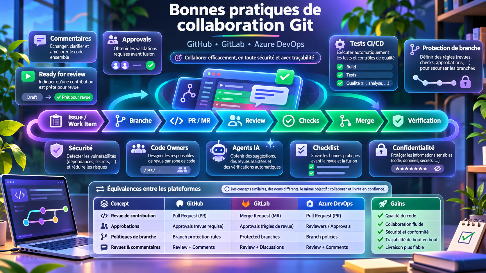

# ProjectHub - Bonnes pratiques de collaboration sur GitHub, GitLab et Azure DevOps

> **Édition publique, statut draft.** Ce guide définit un processus de contribution et de revue applicable aux dépôts Git, sans prétendre que toutes les protections sont déjà configurées sur ProjectHub. Les paramètres varient selon les plateformes et les règles de chaque équipe.



*Illustration synthétique du cycle de collaboration. Les contrôles et les approbations effectifs dépendent des règles configurées sur chaque dépôt et plateforme.*

## 1. Ce que signifie bien collaborer

Une bonne collaboration sur un dépôt Git doit permettre de connaître le **pourquoi**, la **portée**, les **responsables**, les **risques**, les **preuves de qualité** et la **décision de fusion** de chaque changement.

Principes :
- Une modification répond à un besoin ou à une Issue / Work Item identifiable.
- Une branche de travail a une intention claire et des changements raisonnablement limités.
- Un auteur ne confond pas la qualité de son travail avec l'approbation indépendante.
- Les retours de review sont constructifs, discutables et vérifiables.
- Les vérifications automatisées complètent la relecture, sans la remplacer.
- Les informations privées ne doivent pas apparaître dans un dépôt public, même dans une PR Draft.
- Le statut documentaire `draft` n'est pas une validation produit ni un déploiement.
- La contribution d'un agent IA reste soumise à une responsabilité humaine.

## 2. Équivalences des plateformes

| Concept | GitHub | GitLab | Azure DevOps / Azure Repos |
|---|---|---|---|
| Demande de travail | Issue | Issue | Azure Boards Work Item |
| Changement proposé | Pull Request (PR) | Merge Request (MR) | Pull Request (PR) |
| Travail en préparation | Draft PR | Draft MR | PR en préparation selon l'interface |
| Discussion | Conversation / commentaires | Overview / discussions | Discussion de PR |
| Commentaire de diff | Review comment / thread | Diff discussion | Comment thread |
| Approbation formelle | Pull request review | MR approvals et règles | Votes de reviewers et politiques |
| Protection de branche | Rulesets / branch protection | Protected branches | Branch policies |
| Propriété de fichiers | CODEOWNERS | Code Owners | Required reviewers par chemin |
| Contrôles automatisés | GitHub Actions / checks | GitLab CI/CD | Azure Pipelines / build validation |
| Fusion | Merge / squash / rebase | Merge et options configurées | Complete PR, options configurées |

Les mots ressemblent parfois à ceux d'un autre outil sans garantir la même règle d'autorisation.

## 3. Acteurs et responsabilités

| Acteur | Responsabilité | Limite |
|---|---|---|
| Demandeur / Product Owner | Clarifier problème, valeur et critères d'acceptation | Ne décide pas automatiquement des permissions techniques |
| Auteur | Implémenter ou rédiger, tester, décrire et répondre aux commentaires | Ne peut pas inventer une approbation tierce |
| Reviewer | Examiner les changements, risques, cas négatifs et preuves | Ne devrait pas se contenter de la description |
| Code Owner / expert | Apporter une expertise sur un périmètre critique | Ne remplace pas l'autorité métier |
| Mainteneur | Appliquer les règles de fusion, tracer la décision et vérifier le résultat | Ne contourne pas silencieusement les protections |
| Agent IA | Proposer modifications, explications, tests et synthèses | N'est pas un reviewer humain indépendant |

Dans un dépôt tenu par une personne unique, l'auteur et le mainteneur peuvent être la même personne. Cette situation doit être **explicite** et ne constitue pas une review indépendante.

## 4. Cycle complet de travail

```text
Issue / Work Item
    -> cadrage, critères d'acceptation, risques
    -> branche ciblée et commits lisibles
    -> contrôles locaux et tests
    -> PR / MR Draft
    -> Ready for review
    -> revue, discussion, corrections
    -> checks et règles de branche satisfaits
    -> décision de fusion explicite
    -> merge / complete
    -> vérification de main, clôture et suivi
```

### 4.1. Cadrer avant de coder

Documenter un objectif observable, le périmètre et les exclusions, les données concernées, le domaine métier responsable, les dépendances et les critères de réussite. Une décision d'architecture importante peut exiger un ADR avant toute implémentation.

### 4.2. Travailler dans une branche

Noms utiles : `docs/collaboration-best-practices`, `feat/workspace-membership`, `fix/tenant-filter`, `test/export-permissions`. Synchroniser la branche cible avant de commencer ; éviter de pousser des secrets ou données privées, même temporairement.

### 4.3. Commits explicites

Une convention possible, sans obligation de l'adopter immédiatement :

```text
feat: add workspace membership checks
fix: prevent cross-tenant data access
docs: explain code review workflow
test: cover unauthorized exports
chore: add documentation checks
```

Un commit doit avoir une raison intelligible. Une PR doit regrouper **un changement cohérent**, pas des modifications sans lien.

### 4.4. Draft et Ready for review

Une PR Draft sert à échanger sur du travail encore incomplet. Sur un dépôt public, **elle reste publique**, y compris son historique. `Ready for review` signifie « prête pour examen », et **non** « approuvée », « testée » ou « fusionnée ».

### 4.5. Commenter, corriger, fusionner

Les commentaires doivent mentionner l'impact, le scénario ou le test requis. L'auteur répond, corrige les points bloquants, et les contrôles nécessaires sont relancés après les changements. Le mainteneur vérifie ensuite les règles et la branche cible, choisit le mode de fusion, puis contrôle le résultat.

## 5. Commentaires, reviews, approvals : les différences

| Action | Prouve | Ne prouve pas |
|---|---|---|
| Message dans `Conversation` | Une discussion existe | Qu'une review formelle a eu lieu |
| Commentaire sur une ligne | Un problème précis a été soulevé | Que tous les problèmes sont résolus |
| GitHub `Submit review > Comment` | Une review informative a été soumise | Une approbation |
| GitHub `Submit review > Approve` | Un reviewer autorisé approuve | Que tous les checks sont verts |
| GitHub `Request changes` | Des modifications sont demandées | Qu'il existe forcément une protection bloquante |
| `Ready for review` | La PR est ouverte à la revue | Une validation humaine formelle |
| Checks verts | Les outils configurés réussissent | Une validation métier ou de confidentialité |
| `Merged` | Le changement est intégré | Une mise en production ou un pilote autorisé |

### Pourquoi « Comments » et « Approvals » peuvent rester vides

Sur GitHub, un commentaire général de l'auteur sur une PR **n'est pas une review soumise**. Il apparaît dans la conversation sans alimenter un compteur d'approbations formelles.

### À quoi sert « Submit review » sur GitHub ?

Ce bouton permet de soumettre un ensemble de commentaires de revue, d'approuver ou de demander des changements. **L'auteur d'une PR ne peut pas approuver sa propre PR sur GitHub**. Un auteur peut néanmoins publier un commentaire, et un mainteneur qui est aussi l'auteur peut fusionner si les règles du dépôt le permettent. Ce n'est **pas** une approbation indépendante.

### Sur GitLab et Azure Repos

Les validations dépendent des règles d'approbation, Code Owners, protected branches, branch policies, votes de reviewers et contrôles requis. Il faut vérifier explicitement les règles de chaque plateforme au lieu de présumer les mêmes options ou permissions qu'avec GitHub.

## 6. Comment conduire une revue utile

Le reviewer examine :

1. **Besoin** : pourquoi changer et qui bénéficie du résultat ?
2. **Exactitude** : le comportement et les cas d'erreur correspondent-ils aux exigences ?
3. **Sécurité** : authentication, autorisations, isolation multi-tenant, secrets, exports et logs.
4. **Conception** : frontières de domaine, contrats API, migrations, évolutivité, réversibilité.
5. **Qualité** : lisibilité, tests, documentation, observabilité et accessibilité.
6. **Compatibilité** : consommateurs de l'API, données et pratiques existantes.
7. **Preuves** : les tests ont-ils réellement été exécutés sur le bon commit ?
8. **Périmètre** : les changements restent-ils limités à l'objectif annoncé ?

Typologie pratique des retours :

| Niveau | Exemple |
|---|---|
| `Blocking` | « Le filtre par Organization n'est pas appliqué côté API. Ajouter un test négatif avant fusion. » |
| `Major` | « Une migration sans stratégie de reprise présente un risque opérationnel. » |
| `Suggestion` | « Pourrait-on déplacer la responsabilité dans le domaine propriétaire ? » |
| `Question` | « Quelle règle métier autorise ce comportement ? » |
| `Nit` | « Correction de style mineure, non bloquante. » |
| `Praise` | « Le scénario de non-divulgation est bien couvert. » |

La classification est une convention d'équipe, pas forcément une option native de la plateforme.

## 7. Protections et vérifications

Contrôles recommandés pour une branche `main` sensible :
- Pull Request / Merge Request plutôt que push direct.
- Tests, linters, builds, vérification de liens et Markdown selon le périmètre.
- Détection de secrets, analyse des dépendances et triage des alertes.
- Révision des changements significatifs par un reviewer indépendant dès que possible.
- Protections et approbations obligatoires sur fichiers sensibles lorsque l'équipe est prête.
- Exécution des vérifications après les changements post-review.
- Aucun contournement des protections sans incident exceptionnel documenté.

Un scanner qui indique **« No secrets detected »** ne garantit ni l'absence d'informations confidentielles dans le texte, ni la conformité réglementaire.

| Changement | Contrôles complémentaires candidats |
|---|---|
| Documentation | Frontmatter, liens, IDs, confidentialité et diff complet |
| Django / DRF | Tests API, migrations, autorisations, tests négatifs |
| Next.js / React | Type-check, tests, accessibilité |
| Données / migration | Restauration, rollback, compatibilité |
| Intégration | Scopes minimaux, erreurs externes, idempotence |
| Multi-tenant | Accès croisés, recherche, jobs, cache, exports |
| Identité et RBAC | Revue qualifiée, élévation de privilèges et révocation |
| CI/CD | Permissions des tokens, secrets et actions tierces |

**Déploiement progressif des règles** : au stade mainteneur unique, documentation, PR, checks et décision explicite ; en équipe, review indépendante et CODEOWNERS ; en production, protections critiques, contrôle des déploiements et audits. Ne pas bloquer artificiellement la contribution par une règle impossible à satisfaire.

## 8. Fusion, conflits et historique

| Mode | Usage candidat | Attention |
|---|---|---|
| Squash | PR avec plusieurs commits préparatoires | L'historique interne de la branche n'est pas reproduit commit par commit dans `main` |
| Merge commit | Préserver explicitement les commits de la branche | Historique plus ramifié |
| Rebase and merge | Historique linéaire avec commits significatifs | SHA réécrits, coordination nécessaire |
| Merge queue / trains | Dépôt très actif avec changements concurrents | Capacités et règles variables |

Pour les lots de documentation ProjectHub, **squash merge** est un choix raisonnable. Vérifier l'identifiant de commit cible avant de fusionner. Éviter le `force push` sur les branches partagées ; ne réécrire qu'avec coordination.

## 9. Une Issue ou un Work Item utile

Conserver au minimum : **contexte**, **objectif**, **acteur**, **critères d'acceptation**, **dépendances**, **risques**, **preuves** et **décision de clôture**. Les identifiants d'exigences peuvent aider la traçabilité si leur publication est autorisée. Les tickets publics ne doivent jamais devenir un stockage de comptes rendus privés, de secrets ou de données personnelles.

## 10. Modèle de PR / MR à copier

```markdown
## Pourquoi
Issue / Work Item : #...
Problème ou besoin : ...

## Ce qui change
- ...

## Exclusions
- ...

## Risques et impacts
Permissions / données / API / migrations / exploitation : ...

## Vérifications réellement exécutées
- [ ] Tests et résultats documentés
- [ ] Permissions et cas négatifs vérifiés
- [ ] Diff et dépendances relus
- [ ] Confidentialité, licences et documentation vérifiées

## Revue demandée
- [ ] Métier si nécessaire
- [ ] Technique / sécurité si nécessaire
- [ ] Points bloquants résolus
- [ ] Accord humain et règles de branche satisfaits
```

Ne cocher que les étapes réellement effectuées.

## 11. Modèles de commentaires

### Demande de correction

> Merci pour la proposition. Le parcours principal est clair, mais ce endpoint doit être vérifié pour un utilisateur d'une autre Organization. Merci d'ajouter un test de refus avant fusion.

### Réponse à un accord du mainteneur

> Merci pour ta relecture et ton accord. Je prends acte de cette validation du mainteneur. Les contrôles réalisés sont indiqués dans la PR ; je procéderai à la fusion lorsque les règles du dépôt sont satisfaites, puis je vérifierai la branche cible.

### Accord sans review indépendante

> Le diff et le périmètre ont été vérifiés par le mainteneur. Cela ne constitue pas une review indépendante ou une approbation GitHub `APPROVED`.

### Confirmation post-fusion

> La PR a été fusionnée par [méthode] dans [branche], commit [SHA]. Les fichiers sont présents sur la branche cible. Le déploiement et les validations métier restent des étapes distinctes.

## 12. Règles de collaboration avec des agents IA

**Un agent peut** préparer du code, des tests, des documents, commenter, expliquer les risques, rechercher des sources et proposer des correctifs avec des permissions délimitées.

**Un agent ne doit pas** s'auto-approuver, inventer des tests, fermer une question métier sans preuve, publier des sources confidentielles ou agir au-delà des permissions autorisées.

Pour toute PR assistée par IA :
- indiquer les modifications générées ou relues avec assistance ;
- distinguer les tests réellement exécutés des tests seulement proposés ;
- limiter les données et permissions disponibles à l'agent ;
- éviter de placer des secrets ou informations tierces dans le contexte public ;
- conserver une décision humaine explicite pour publication, sécurité, export et déploiement ;
- vérifier manuellement les exigences métier et les scénarios de fuite entre tenants.

**Principe : l'IA propose et documente ; l'autorité humaine décide.**

## 13. Confidentialité, licences et sécurité

- Une PR Draft sur un dépôt public est **publique** : contrôler le contenu avant le premier push.
- Éviter les captures d'écran, contrats, verbatims, fichiers et données de tiers non autorisés.
- En cas d'exposition d'un secret, le révoquer et le renouveler ; supprimer un commit ne garantit pas l'effacement des copies.
- Vérifier les licences, droits d'utilisation des images, logos et dépendances.
- Prévoir un canal privé pour les vulnérabilités sensibles.
- **Un dépôt public n'accorde pas, à lui seul, les droits d'une licence open source.**
- Pour ProjectHub, la [politique de publication](PUBLICATION-POLICY.md) s'applique avant de proposer des documents privés.

## 14. Processus spécifique à ProjectHub

Au stade actuel de la Discovery documentaire :

1. Une livraison documentaire forme un lot cohérent et une branche dédiée.
2. Les documents publics sont réécrits et expurgés, avec statut `draft` si non approuvés.
3. Contrôler frontmatter, IDs, liens, diff et confidentialité avant Ready.
4. Le mainteneur examine la PR et laisse une décision explicite dans Conversation.
5. L'agent peut répondre au commentaire, mais ne présente pas ce dialogue comme une review indépendante.
6. Fusionner après satisfaction des règles et accord, de préférence par squash pour un lot documentaire.
7. Vérifier `main` et actualiser l'index avant de déclarer le lot terminé.
8. Introduire une seconde revue humaine indépendante lorsque l'équipe grandit, et immédiatement pour les changements critiques si possible.

**Attention :** un feu vert sur la documentation n'autorise pas un pilote E1 avec données réelles. Les contrôles d'isolation, de sauvegarde, d'exploitation et les accords institutionnels sont distincts.

## 15. Checklists opérationnelles

### Auteur
- [ ] Ticket, besoin et critères d'acceptation.
- [ ] Branche adaptée, diff limité.
- [ ] Aucun secret ni document privé.
- [ ] Tests réellement exécutés, résultats documentés.
- [ ] Cas d'accès non autorisés testés si concernés.
- [ ] Documentation et migrations mises à jour.
- [ ] Description claire de PR/MR et reviewers identifiés.

### Reviewer ou mainteneur
- [ ] Comprendre le besoin et les risques.
- [ ] Lire le diff complet.
- [ ] Contrôler permissions, données et réversibilité.
- [ ] Vérifier les preuves et leur fraîcheur.
- [ ] Fournir des commentaires précis.
- [ ] Résoudre les points bloquants.
- [ ] Appliquer les protections et approbations pertinentes.
- [ ] Vérifier le commit et la branche après fusion.

## 16. Exemple de commandes Git

Les commandes suivantes sont **des exemples non exécutés** :

```bash
git switch main
git pull --ff-only
git switch -c docs/collaboration-best-practices
git status --short
git diff --check

git add docs/COLLABORATION-BEST-PRACTICES.md docs/README.md
git diff --cached --check
git diff --cached

git commit -m "docs: add cross-platform collaboration best practices"
git push -u origin docs/collaboration-best-practices

# Avec GitHub CLI installé et authentifié :
gh pr create --base main --head docs/collaboration-best-practices \
  --draft \
  --title "docs: add cross-platform collaboration best practices" \
  --body "Guide proposé à la revue humaine."
```

Sur GitLab, utiliser une **Merge Request** ; sur Azure Repos, une **Pull Request** liée au Work Item, selon les options de l'interface et de la CLI du fournisseur.

## 17. Documentations officielles

### GitHub
- [Reviewing proposed changes](https://docs.github.com/en/pull-requests/how-tos/review-pull-requests/reviewing-proposed-changes-in-a-pull-request)
- [Approving pull requests](https://docs.github.com/en/pull-requests/how-tos/review-pull-requests/approving-a-pull-request-with-required-reviews)
- [Changing a pull request stage](https://docs.github.com/en/pull-requests/how-tos/create-pull-requests/changing-the-stage-of-a-pull-request)
- [Status checks](https://docs.github.com/en/pull-requests/reference/status-checks)
- [CODEOWNERS](https://docs.github.com/en/repositories/managing-your-repositorys-settings-and-features/customizing-your-repository/about-code-owners)

### GitLab
- [Merge request approvals](https://docs.gitlab.com/user/project/merge_requests/approvals/)
- [Approval rules](https://docs.gitlab.com/user/project/merge_requests/approvals/rules/)
- [Code Owners](https://docs.gitlab.com/user/project/codeowners/)
- [Protected branches](https://docs.gitlab.com/user/project/repository/branches/protected/)

### Azure DevOps / Azure Repos
- [About pull requests](https://learn.microsoft.com/en-us/azure/devops/repos/git/about-pull-requests)
- [Pull request workflow](https://learn.microsoft.com/en-us/azure/devops/repos/git/pull-requests)
- [Branch policies](https://learn.microsoft.com/en-us/azure/devops/repos/git/branch-policies-overview)
- [Secure repositories and pull requests](https://learn.microsoft.com/en-us/azure/devops/repos/git/secure-repositories-pull-requests)

## 18. Suivi du document

| Version | Date | Statut |
|---|---|---|
| 0.1.0 | 2026-11-20 | Brouillon public à faire relire |

Toute évolution des règles de collaboration doit être proposée par PR/MR et revue au regard du contexte réel de l'équipe.
